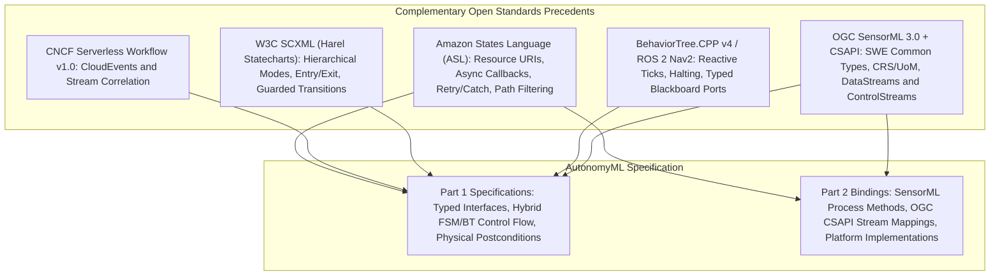
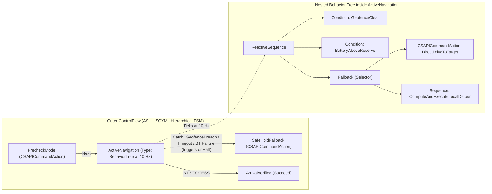

# Architectural Precedents for AutonomyML: Amazon States Language (ASL) and Complementary Open Standards

## Executive Summary

AutonomyML sits at the intersection of **Finite State Machines (FSMs)**, **Behavior Trees (BTs)**, **Typed Process Dataflow** ([OGC SensorML 3.0](https://docs.ogc.org/is/23-000/23-000.html) + SWE Common 3.0), and **Standardized System Interaction** ([OGC API - Connected Systems](https://ogcapi.ogc.org/connectedsystems/)). Because autonomous UxS capabilities combine discrete operational modes, high-rate reactive behavior, physical units/coordinate frames, and asynchronous actuation over real-world telemetry, no single existing specification covers 100% of AutonomyML's scope.

However, examining **Amazon States Language (ASL)** alongside three complementary open standards—**CNCF Serverless Workflow**, **W3C SCXML**, and **BehaviorTree.CPP v4 (ROS 2 Nav2)**—provides a battle-tested architectural blueprint for nearly every mechanism in [AutonomyML Overview.md](../../AutonomyML%20Overview.md).



---

## 1. Amazon States Language (ASL): What to Borrow

[Amazon States Language (ASL)](https://states-language.net/)—the declarative JSON specification behind AWS Step Functions—is one of the strongest industry precedents for a portable, JSON-based Finite State Machine language that cleanly separates **control flow** from **task execution**.

Four foundational ASL patterns map directly onto AutonomyML's architecture:

### 1.1 Abstract Task Invocation (`Resource` URIs $\rightarrow$ Part 1 vs. Part 2 Separation)

* **In ASL:** A `Task` state never embeds imperative implementation code; instead, it references a logical `Resource` URI (an ARN) and supplies structured parameters.
* **In AutonomyML:** This maps directly to the separation between **Part 1 (Specifications)** and **Part 2 (Bindings)**:
  * **Part 1** capability definitions reference symbolic capability or actuation URIs (for example, `urn:autonomyml:capability:uxs-aerial:Takeoff` or `urn:autonomyml:binding:controlstream:Navigate2D`).
  * **Part 2** bindings resolve those logical URIs to concrete system interactions—such as an OGC CSAPI `ControlStream` endpoint managed by a connector layer (e.g., `semconnect`) or an onboard SensorML computational process—without changing the portable behavior model.

### 1.2 Asynchronous Callback Pattern (`.waitForTaskToken` $\rightarrow$ Physical Postcondition Proof)

* **In ASL:** Appending `.waitForTaskToken` to a `Task` resource causes the state machine to dispatch a request and pause in that state until an external worker proves completion via `SendTaskSuccess` / `SendTaskFailure` (or until `TimeoutSeconds` / `HeartbeatSeconds` expires).
* **In AutonomyML:** Physical autonomy enforces a strict invariant: **Command Accepted $\neq$ Action Completed**. An HTTP `201 Created` or `ACCEPTED` command status on an OGC CSAPI `ControlStream` only confirms command receipt—not physical achievement. Borrowing ASL's asynchronous task lifecycle, an AutonomyML action state:
  1. Dispatches the command (`POST /controlstreams/{id}/commands`),
  2. Remains `RUNNING` while monitoring incoming `DataStream` observations, and
  3. Transitions to `Next` only when a **Postcondition** predicate (compiled, for example, into a `semengine` Postcondition Rule Pack) proves sustained physical completion over telemetry.

### 1.3 Structured Fault Recovery (`Retry` and `Catch` $\rightarrow$ Safe-State Transitions)

* **In ASL:** Every `Task` or `Parallel` state supports declarative `Retry` policies (with backoff) and ordered `Catch` blocks that route typed runtime errors (`States.Timeout`, `States.TaskFailed`, custom fault names) to explicit recovery states.
* **In AutonomyML:** `Retry` and `Catch` provide a clear, auditable syntax for **Approved Fault and Safe-State Plans** in domain profiles:
  * **Aerial UxS Profile:** `Catch: ["AutonomyML.TelemetryStale", "AutonomyML.GeofenceBreach"]` $\rightarrow$ `Next: "ExecuteRTL"` (or `ExecuteLandImmediate` on critical battery).
  * **Ground Rover Profile:** `Catch: ["AutonomyML.TelemetryStale", "AutonomyML.PostconditionTimeout", "CSAPI.CommandFailed"]` $\rightarrow$ `Next: "SafeHoldFallback"`.

### 1.4 Explicit Dataflow Filtering (`InputPath`/`Parameters`/`OutputPath` & JSONata `Arguments`/`Assign`)

* **In ASL:** Data movement into and out of each state is explicitly scoped—historically via JSONPath filters (`InputPath`, `Parameters`, `ResultSelector`, `ResultPath`, `OutputPath`) and, in modern ASL, via declarative JSONata expressions (`Arguments`, `Assign`, `Output`). State transitions never rely on hidden side effects inside opaque scripts.
* **In AutonomyML:** Explicit path/variable wiring provides a clean JSON ergonomics model for connecting **SensorML typed inputs, parameters, and outputs** across states and Blackboard ports while keeping data lineage inspectable by static validators and operator tools.

### 1.5 Where ASL Falls Short for AutonomyML

Despite its strengths for discrete workflow orchestration, ASL leaves three critical gaps when applied to robotics and autonomous UxS:

1. **FSM-Only (No Reactive Behavior Trees):** ASL is strictly a discrete state-transition graph. It lacks reactive Behavior Tree ticks (`RUNNING`, `SUCCESS`, `FAILURE` propagating bottom-up through `ReactiveSequence` and `Fallback` nodes at $N\text{ Hz}$) and hierarchical preemption/halting of active subtrees.
2. **Weak Semantic Typing:** ASL passes untyped JSON values. AutonomyML relies on **OGC SensorML 3.0 / SWE Common 3.0** (and domain vocabularies such as `semvocab`) to enforce physical units of measure (`uom`), coordinate reference frames (`EPSG:4326` WGS84 vs. local `NED` / `ENU` body frames), quantity intervals, and observable property definitions.
3. **Discrete RPC Events vs. Continuous Telemetry Streams:** ASL is designed around discrete request/response invocations rather than continuous sensor observation streams (`/datastreams/{id}/observations`), sliding time windows, staleness bounds, and sustained physical predicates (`SustainDurationSeconds`).

---

## 2. Three Complementary Standards to Pair with ASL

Pairing ASL with three established open standards covers every concern in the [AutonomyML Overview.md](../../AutonomyML%20Overview.md) implementation table:

| Project / Standard | What It Is | Gap It Fills for AutonomyML | Mapping to AutonomyML Overview |
| :--- | :--- | :--- | :--- |
| **[CNCF Serverless Workflow (v1.0)](https://serverlessworkflow.io/)** | Vendor-neutral, open-source JSON/YAML workflow & state specification built natively around [CNCF CloudEvents](https://cloudevents.io/). | **Native Event & Stream Correlation:** Its `listen` tasks (`to.one` / `to.all` / `to.any`) filter incoming events via `with` attributes and bind them to active execution instances via `correlate` (`from` / `expect`). Models how an AutonomyML runtime correlates outgoing CSAPI `ControlStream` commands with incoming `DataStream` observation and command-status streams. | *State/Event Exchange* (Part 1) & *OGC CSAPI Interaction* |
| **[W3C SCXML (State Chart XML)](https://www.w3.org/TR/scxml/)** | The W3C Recommendation for Harel Statecharts (hierarchical and orthogonal FSMs). | **Hierarchical Modes, Lifecycles & Guards:** Defines nested `<state>` hierarchies (e.g., macro-mode `Armed` containing `Guided`, `Survey`, and `Hold` sub-modes), orthogonal `<parallel>` regions, deterministic `<onentry>` / `<onexit>` actions, and guarded transitions (`cond="..."`). Provides formal operational semantics suitable for compilation into rule engines and model checkers. | *Modes and transitions (FSMs)* & *Execution Lifecycles* |
| **[BehaviorTree.CPP (v4)](https://www.behaviortree.dev/) & [ROS 2 Nav2](https://docs.nav2.org/)** | De facto robotics Behavior Tree execution model and XML/port schema. | **Reactive Task Composition & Typed Blackboard Ports:** Defines `Sequence`, `Fallback` (Selector), `ReactiveSequence` (re-evaluates safety/precondition guards on every tick and halts `RUNNING` children immediately on failure), `StatefulActionNode` (`onStart` / `onRunning` / `onHalt`), and explicit `InputPort` / `OutputPort` bindings over a shared Blackboard—mapping 1:1 to SensorML ports. | *Reactive task composition (BTs)* & *SensorML Dataflow* |

### Deep-Dive Notes on the Complementary Trio

* **Event Correlation from CNCF Serverless Workflow:** When a vehicle executes a command over OGC CSAPI Part 2 (`OGC 23-002`), observations arrive asynchronously on `/datastreams` while command lifecycle updates (`ACCEPTED`, `EXECUTING`, `COMPLETED`, `FAILED`) arrive on `/commands/{cmdId}/status`. Serverless Workflow's declarative `correlate` pattern demonstrates how to bind `systemId`, `commandId`, and temporal freshness constraints without custom imperative glue code.
* **Hierarchical Mode Invariants from W3C SCXML:** Flat FSMs suffer from transition explosion: if 8 mission states all share the same `GeofenceBreach` and `CommsLost` transitions, every state must duplicate those `Catch` handlers. Borrowing SCXML's hierarchical compound states allows an enclosing `ArmedMode` state to declare mode-wide `<onexit>` cleanup and fault `Catch` transitions once, inherited automatically by all nested states. Furthermore, robotics verification toolchains (such as the EU CONVINCE / AS2FM framework) already demonstrate translating hybrid BT.CPP + SCXML models into formal verification targets.
* **Preemption (`onHalt`) and Blackboard Ports from BT.CPP v4:** Unlike fire-and-forget workflow tasks, physical robot actions must support clean preemption when a higher-priority condition changes mid-execution. BT.CPP's `StatefulActionNode` lifecycle (`onStart` $\rightarrow$ `onRunning` $\rightarrow$ `onHalt`) gives AutonomyML a crisp contract for cancelling or superseding an active CSAPI `ControlStream` command whenever a parent `ReactiveSequence` guard fails or an enclosing FSM `Catch` triggers.

---

## 3. Side-by-Side Example: ASL vs. ASL-Inspired AutonomyML

Compare a standard Amazon States Language `Task` definition with an AutonomyML capability that preserves ASL's developer-friendly structure (`StartAt`, `States`, `Type`, `Resource`, `Parameters`, `TimeoutSeconds`, `Catch`, `Next`) while adding **Domain Profiles**, **SensorML/SWE Common typed ports**, and **OGC CSAPI physical postconditions**.

### 3.1 Standard Amazon States Language (ASL)

```json
{
  "StartAt": "NavigateToWaypoint",
  "States": {
    "NavigateToWaypoint": {
      "Type": "Task",
      "Resource": "arn:aws:states:::lambda:invoke.waitForTaskToken",
      "Parameters": {
        "lat.$": "$.mission.targetLat",
        "lon.$": "$.mission.targetLon"
      },
      "TimeoutSeconds": 60,
      "Catch": [
        {
          "ErrorEquals": ["States.Timeout", "NavigationFault"],
          "Next": "SafeHoldState"
        }
      ],
      "Next": "VerifyArrival"
    },
    "VerifyArrival": {
      "Type": "Succeed"
    },
    "SafeHoldState": {
      "Type": "Fail",
      "Error": "NavigationAborted",
      "Cause": "Waypoint navigation timed out or faulted."
    }
  }
}
```

### 3.2 AutonomyML Part 1 Equivalent (Specification: FSM + SensorML Ports + Postconditions)

```json
{
  "autonomyMLVersion": "0.1.0",
  "kind": "CapabilitySpecification",
  "profile": "urn:semvocab:profile:uxs-ground-rover:1.0",
  "capabilityId": "urn:autonomyml:capability:uxs-ground-rover:WaypointNavigation:0.1.0",
  "interface": {
    "comment": "SensorML 3.0 / SWE Common 3.0 aligned typed ports (validated against profile vocabulary)",
    "inputs": {
      "targetWaypoint": {
        "type": "Vector",
        "definition": "http://www.opengis.net/def/property/OGC/0/PlatformLocation",
        "referenceFrame": "http://www.opengis.net/def/crs/EPSG/0/4326",
        "coordinates": [
          { "name": "lat", "type": "Quantity", "axisID": "Lat", "uom": { "code": "deg" } },
          { "name": "lon", "type": "Quantity", "axisID": "Lon", "uom": { "code": "deg" } }
        ]
      }
    },
    "parameters": {
      "arrivalRadius": {
        "type": "Quantity",
        "definition": "urn:autonomyml:def:parameter:ArrivalAcceptanceRadius",
        "uom": { "code": "m" },
        "value": 1.5
      }
    },
    "outputs": {
      "achievedPosition": {
        "type": "Vector",
        "referenceFrame": "http://www.opengis.net/def/crs/EPSG/0/4326",
        "coordinates": [
          { "name": "lat", "type": "Quantity", "axisID": "Lat", "uom": { "code": "deg" } },
          { "name": "lon", "type": "Quantity", "axisID": "Lon", "uom": { "code": "deg" } }
        ]
      }
    }
  },
  "controlFlow": {
    "StartAt": "DriveToWaypoint",
    "States": {
      "DriveToWaypoint": {
        "Type": "CSAPICommandAction",
        "Resource": "urn:autonomyml:binding:controlstream:Navigate2D",
        "Parameters": {
          "target.$": "$.interface.inputs.targetWaypoint"
        },
        "Postcondition": {
          "ObservationStream": "urn:autonomyml:binding:datastream:VehiclePose",
          "MaxObservationAgeSeconds": 1.0,
          "Condition": "distance2D($.observation.position, $.interface.inputs.targetWaypoint) <= $.interface.parameters.arrivalRadius",
          "SustainDurationSeconds": 2.0
        },
        "ResultPath": "$.interface.outputs.achievedPosition",
        "TimeoutSeconds": 120,
        "Catch": [
          {
            "ErrorEquals": [
              "AutonomyML.TelemetryStale",
              "AutonomyML.PostconditionTimeout",
              "CSAPI.CommandFailed"
            ],
            "Next": "SafeHoldFallback"
          }
        ],
        "Next": "HoldAtWaypoint"
      },
      "HoldAtWaypoint": {
        "Type": "Succeed"
      },
      "SafeHoldFallback": {
        "Type": "CSAPICommandAction",
        "Resource": "urn:autonomyml:binding:controlstream:HoldPosition",
        "Postcondition": {
          "ObservationStream": "urn:autonomyml:binding:datastream:VehicleVelocity",
          "MaxObservationAgeSeconds": 1.0,
          "Condition": "$.observation.groundSpeed <= 0.1",
          "SustainDurationSeconds": 3.0
        },
        "Next": "SafeHoldTerminated"
      },
      "SafeHoldTerminated": {
        "Type": "Fail",
        "Error": "AutonomyML.SafeStateEngaged",
        "Cause": "Vehicle transitioned to verified zero-velocity hold after navigation fault."
      }
    }
  }
}
```

> **Note on SensorML 3.0 (OGC 23-000) Encoding Alignment:** In OGC SensorML 3.0 / SWE Common 3.0 JSON schemas, `Quantity` units of measure use `"uom": { "code": "deg" }` (UCUM code) or `"uom": { "href": "..." }`, and spatial vectors declare `"type": "Vector"` with an explicit `"referenceFrame"` URI. AutonomyML authoring tools can optionally support compact string shorthands (e.g., `"uom": "deg"`) that canonicalize to strict SWE Common 3.0 JSON during validation.

### 3.3 Companion AutonomyML Part 2 Binding (Concrete OGC CSAPI Resolution)

Because `DriveToWaypoint` and `SafeHoldFallback` only reference logical `urn:autonomyml:binding:*` URIs, two completely different ground rovers (e.g., a ROS 2 Nav2 UGV vs. an ArduRover/MAVLink UGV exposed via OGC CSAPI) can satisfy the **exact same Part 1 capability** by supplying their own **Part 2 Binding**:

```json
{
  "autonomyMLVersion": "0.1.0",
  "kind": "CapabilityBinding",
  "capabilityRef": "urn:autonomyml:capability:uxs-ground-rover:WaypointNavigation:0.1.0",
  "targetSystem": "urn:ogc:def:system:ugv-alpha-01",
  "csapiBaseUrl": "https://csapi.example.org/ogcapi",
  "controlStreamBindings": {
    "urn:autonomyml:binding:controlstream:Navigate2D": {
      "controlStreamPath": "/controlstreams/ugv-alpha-01-nav2d",
      "commandSchema": "urn:ogc:def:csapi:command:GoalPose2D",
      "onHaltAction": {
        "method": "POST",
        "controlStreamPath": "/controlstreams/ugv-alpha-01-hold",
        "payload": { "mode": "BRAKE_HOLD" }
      }
    },
    "urn:autonomyml:binding:controlstream:HoldPosition": {
      "controlStreamPath": "/controlstreams/ugv-alpha-01-hold",
      "commandSchema": "urn:ogc:def:csapi:command:HoldPosition"
    }
  },
  "dataStreamBindings": {
    "urn:autonomyml:binding:datastream:VehiclePose": {
      "dataStreamPath": "/datastreams/ugv-alpha-01-gnss-ins-pose",
      "expectedRateHz": 10.0
    },
    "urn:autonomyml:binding:datastream:VehicleVelocity": {
      "dataStreamPath": "/datastreams/ugv-alpha-01-twist",
      "expectedRateHz": 10.0
    }
  }
}
```

---

## 4. Unifying FSMs and Behavior Trees in One Schema

A central architectural question for AutonomyML is how the **FSM** row (*"Modes and transitions"*) and the **Behavior Tree** row (*"Reactive task composition"*) in [AutonomyML Overview.md](../../AutonomyML%20Overview.md) fit together cleanly without forcing authors into awkward workarounds.

### 4.1 Architectural Principle: Mode Supervision (FSM) + Reactive Execution (BT)

In safety-critical robotics, FSMs and Behavior Trees are complementary rather than competing formalisms:

* **Hierarchical FSMs excel at Macro-Modes and Lifecycle Governance:** System modes (`Disarmed`, `Armed.Idle`, `Armed.ActiveNavigation`, `SafeHoldFallback`, `EmergencyRTL`) have mutually exclusive operational envelopes, mode-entry/exit invariants (SCXML `<onentry>` / `<onexit>`), and regulatory safe-state fault transitions (ASL `Catch`).
* **Behavior Trees excel at High-Rate Reactive Task Composition inside an Active Mode:** Within an active mode like `Armed.ActiveNavigation`, the vehicle must continuously evaluate environmental conditions (geofence clearance, obstacle proximity, link quality) at $N\text{ Hz}$ while sequencing local actions and fallbacks (e.g., try local path following; on path obstruction, invoke local replanning; if geofence is breached, halt immediately).

AutonomyML unifies both formalisms through **bidirectional, typed composition** over a shared **SensorML Blackboard**:

1. **FSM Hosting a Behavior Tree (`"Type": "BehaviorTree"` State):** Any state in an AutonomyML `controlFlow` state machine can declare `"Type": "BehaviorTree"` with an explicit `TickRateHz` and `Root` node (`ReactiveSequence`, `Sequence`, `Fallback`, `ReactiveFallback`, `Parallel`).
   * `SUCCESS` at the BT root transitions the enclosing FSM state to `Next`.
   * `RUNNING` at the BT root keeps the FSM in the current state for the next tick (subject to `TimeoutSeconds`).
   * `FAILURE` at the BT root raises a typed fault (`AutonomyML.BehaviorTreeFailed` or a specific guard error such as `AutonomyML.GeofenceBreach`) that routes cleanly through the enclosing FSM's `Catch` block—calling `onHalt` on any active leaf action first.
2. **Behavior Tree Invoking a Sub-Capability (`"Type": "InvokeCapability"` Leaf):** Conversely, any BT leaf action can invoke another reusable AutonomyML capability URI whose internal implementation may itself be an FSM, a SensorML `AggregateProcess`, or another BT—returning `RUNNING` until that sub-capability's physical `Postcondition` succeeds.



### 4.2 Unified Hybrid Schema Sketch (FSM + Reactive BT + SensorML Blackboard)

The example below extends `WaypointNavigation` into a hybrid capability where the outer FSM governs lifecycle and safe-state recovery while the `ActiveNavigation` state ticks a reactive Behavior Tree at `10 Hz` over SensorML-typed Blackboard variables:

```json
{
  "autonomyMLVersion": "0.1.0",
  "kind": "CapabilitySpecification",
  "profile": "urn:semvocab:profile:uxs-ground-rover:1.0",
  "capabilityId": "urn:autonomyml:capability:uxs-ground-rover:GuardedWaypointNavigation:0.1.0",
  "interface": {
    "inputs": {
      "targetWaypoint": {
        "type": "Vector",
        "referenceFrame": "http://www.opengis.net/def/crs/EPSG/0/4326",
        "coordinates": [
          { "name": "lat", "type": "Quantity", "axisID": "Lat", "uom": { "code": "deg" } },
          { "name": "lon", "type": "Quantity", "axisID": "Lon", "uom": { "code": "deg" } }
        ]
      },
      "geofencePolygon": {
        "type": "DataRecord",
        "definition": "urn:autonomyml:def:geometry:InclusionCorridor2D"
      }
    },
    "parameters": {
      "arrivalRadius": { "type": "Quantity", "uom": { "code": "m" }, "value": 1.5 },
      "minReserveSoc": { "type": "Quantity", "uom": { "code": "%" }, "value": 20.0 }
    }
  },
  "blackboard": {
    "comment": "Shared SensorML-typed state populated from CSAPI DataStreams and internal process ports",
    "vehiclePose": {
      "sourceStream": "urn:autonomyml:binding:datastream:VehiclePose",
      "maxAgeSeconds": 0.5,
      "type": "Vector",
      "referenceFrame": "http://www.opengis.net/def/crs/EPSG/0/4326"
    },
    "batterySoc": {
      "sourceStream": "urn:autonomyml:binding:datastream:BatteryStatus",
      "maxAgeSeconds": 2.0,
      "type": "Quantity",
      "uom": { "code": "%" }
    },
    "detourWaypoint": {
      "type": "Vector",
      "referenceFrame": "http://www.opengis.net/def/crs/EPSG/0/4326"
    }
  },
  "controlFlow": {
    "StartAt": "ActiveNavigation",
    "States": {
      "ActiveNavigation": {
        "Type": "BehaviorTree",
        "TickRateHz": 10.0,
        "TimeoutSeconds": 180,
        "Root": {
          "NodeType": "ReactiveSequence",
          "Name": "SafetyGuardedDrive",
          "Children": [
            {
              "NodeType": "Condition",
              "Name": "GeofenceClear",
              "Expression": "withinPolygon($.blackboard.vehiclePose, $.interface.inputs.geofencePolygon)",
              "FailureError": "AutonomyML.GeofenceBreach"
            },
            {
              "NodeType": "Condition",
              "Name": "BatteryAboveReserve",
              "Expression": "$.blackboard.batterySoc >= $.interface.parameters.minReserveSoc",
              "FailureError": "AutonomyML.LowBatteryReserve"
            },
            {
              "NodeType": "Fallback",
              "Name": "NavigateOrDetour",
              "Children": [
                {
                  "NodeType": "CSAPICommandAction",
                  "Name": "DirectDriveToTarget",
                  "Resource": "urn:autonomyml:binding:controlstream:Navigate2D",
                  "InputPorts": {
                    "target": "$.interface.inputs.targetWaypoint"
                  },
                  "Postcondition": {
                    "ObservationStream": "urn:autonomyml:binding:datastream:VehiclePose",
                    "Condition": "distance2D($.observation.position, $.interface.inputs.targetWaypoint) <= $.interface.parameters.arrivalRadius",
                    "SustainDurationSeconds": 2.0
                  }
                },
                {
                  "NodeType": "Sequence",
                  "Name": "ComputeAndExecuteLocalDetour",
                  "Children": [
                    {
                      "NodeType": "SensorMLProcess",
                      "Name": "ComputeLocalDetour",
                      "Process": "urn:autonomyml:process:LocalObstacleAvoidancePlanner",
                      "InputPorts": {
                        "currentPose": "$.blackboard.vehiclePose",
                        "goal": "$.interface.inputs.targetWaypoint"
                      },
                      "OutputPorts": {
                        "detourGoal": "$.blackboard.detourWaypoint"
                      }
                    },
                    {
                      "NodeType": "CSAPICommandAction",
                      "Name": "DriveDetourSegment",
                      "Resource": "urn:autonomyml:binding:controlstream:Navigate2D",
                      "InputPorts": {
                        "target": "$.blackboard.detourWaypoint"
                      },
                      "Postcondition": {
                        "ObservationStream": "urn:autonomyml:binding:datastream:VehiclePose",
                        "Condition": "distance2D($.observation.position, $.blackboard.detourWaypoint) <= $.interface.parameters.arrivalRadius",
                        "SustainDurationSeconds": 1.0
                      }
                    }
                  ]
                }
              ]
            }
          ]
        },
        "Catch": [
          {
            "ErrorEquals": [
              "AutonomyML.GeofenceBreach",
              "AutonomyML.LowBatteryReserve",
              "AutonomyML.TelemetryStale",
              "AutonomyML.PostconditionTimeout",
              "AutonomyML.BehaviorTreeFailed"
            ],
            "Next": "SafeHoldFallback"
          }
        ],
        "Next": "NavigationSucceeded"
      },
      "NavigationSucceeded": {
        "Type": "Succeed"
      },
      "SafeHoldFallback": {
        "Type": "CSAPICommandAction",
        "Resource": "urn:autonomyml:binding:controlstream:HoldPosition",
        "Postcondition": {
          "ObservationStream": "urn:autonomyml:binding:datastream:VehicleVelocity",
          "MaxObservationAgeSeconds": 1.0,
          "Condition": "$.observation.groundSpeed <= 0.1",
          "SustainDurationSeconds": 3.0
        },
        "Next": "SafeHoldActive"
      },
      "SafeHoldActive": {
        "Type": "Fail",
        "Error": "AutonomyML.SafeStateEngaged",
        "Cause": "Reactive safety guard or navigation timeout triggered verified hold state."
      }
    }
  }
}
```

Notice how all five concerns of the [AutonomyML Overview.md](../../AutonomyML%20Overview.md) implementation table participate seamlessly in a single declarative artifact:

1. **OGC CSAPI:** Logical `ControlStream` and `DataStream` URIs (`Navigate2D`, `HoldPosition`, `VehiclePose`, `BatteryStatus`) bound cleanly in Part 2.
2. **SensorML / SWE Common:** Typed `interface` and `blackboard` ports (`Vector`, `Quantity`, `DataRecord`, explicit `EPSG:4326` CRS and UCUM `uom` codes) plus inline `SensorMLProcess` nodes (`ComputeLocalDetour`).
3. **FSMs:** Explicit operational states (`ActiveNavigation`, `SafeHoldFallback`, `NavigationSucceeded`) and deterministic `Catch` safe-state transitions.
4. **BTs:** Tick-driven `ReactiveSequence`, `Fallback`, and `Sequence` nodes that re-verify safety invariants (`GeofenceClear`, `BatteryAboveReserve`) at `10 Hz` and preempt active motions on violation.
5. **Executable Algorithms:** Referenced cleanly via `Process` (`urn:autonomyml:process:LocalObstacleAvoidancePlanner`) and CSAPI bindings without leaking implementation-specific code into Part 1.

---

## 5. Strategic Benefits for the AutonomyML Working Group

### 5.1 Instant Developer & Systems Engineer Familiarity
Cloud and distributed-systems engineers already recognize ASL / Serverless Workflow (`StartAt`, `States`, `Resource`, `Parameters`, `Catch`), robotics engineers immediately recognize BT.CPP (`ReactiveSequence`, `Fallback`, Blackboard `InputPorts`/`OutputPorts`), and geospatial/sensor-web practitioners recognize SensorML 3.0 and OGC CSAPI. Framing AutonomyML as the principled synthesis of these standards dramatically lowers adoption friction across working group partners.

### 5.2 Deterministic Compilation to Execution Engines
Just as AWS compiles declarative ASL JSON into deterministic state-transition evaluators, a reference AutonomyML runtime (for example, `semautonomy` operating over `semengine`, `semvocab`, and `semconnect`) can compile every AutonomyML capability directly into deterministic execution rules:
* **`semvocab` / Profile Validator:** Validates `interface` and `blackboard` SWE Common types, UoMs, CRS frames, and required profile safe-state handlers at load time.
* **`semengine` Rule Packs:** Compiles FSM state transitions, `ReactiveSequence` tick guards, temporal staleness checks (`MaxObservationAgeSeconds`), and sustained physical `Postcondition` predicates (`SustainDurationSeconds`) into deterministic rules over a Semantic Knowledge Graph (SKG).
* **`semconnect` CSAPI Adapter:** Resolves Part 2 `CapabilityBinding` resources to live OGC CSAPI `/controlstreams` and `/datastreams` endpoints, executing `onHaltAction` cancellations automatically whenever a state or BT subtree is preempted.

### 5.3 Reusable Open-Source Tooling Patterns
Because ASL, CNCF Serverless Workflow, and SensorML 3.0 are JSON Schema-driven—and BT.CPP / SCXML have mature visual inspection paradigms (such as Groot2 and statechart visualizers)—AutonomyML operator and authoring tools can share a single JSON Schema source of truth across **Graph**, **JSON**, and **Bindings** views, as well as static safety linters (e.g., verifying that every non-terminal physical action state has a bounded timeout and a reachable safe-state `Catch` transition).

---

## 6. Open Design Questions for Specification Drafting

As this research feeds into **AutonomyML Part 1 (Specifications)** and **Part 2 (Bindings)** drafting, four concrete design decisions warrant working-group alignment:

1. **Predicate & Dataflow Expression Language:** Should `Condition` predicates and port mappings standardize on a deterministic, side-effect-free subset of **JSONata** (following modern ASL), **Common Expression Language (CEL)**, or a domain-extended **JSONPath + spatial/temporal built-ins** (`distance2D`, `withinPolygon`, `sustainedFor`)?
2. **Preemption & `onHalt` Contract:** When a `ReactiveSequence` guard fails or an enclosing FSM `Catch` preempts a `RUNNING` `CSAPICommandAction`, should Part 2 bindings require every continuous `ControlStream` binding to declare an explicit `onHaltAction` (e.g., `DELETE /commands/{id}` vs. issuing a superseding hold command)?
3. **Hierarchical Compound States (`SCXML` Alignment):** Should `controlFlow.States` allow nested compound `States` (so an `Armed` parent state can define shared `<onentry>`, `<onexit>`, and `Catch` blocks once for all child modes) in v0.1, or keep v0.1 flat and compose hierarchy strictly via nested sub-capabilities?
4. **Canonical vs. Compact SWE Common Port Syntax:** Should Part 1 mandate strict OGC SensorML 3.0 / SWE Common 3.0 JSON schemas verbatim inside `interface` and `blackboard`, or permit a concise authoring shorthand that deterministically expands to canonical SWE Common 3.0 JSON?

---

## 7. References

1. **AutonomyML Overview** — [AutonomyML Overview.md](../../AutonomyML%20Overview.md)
2. **Amazon States Language (ASL) Specification** — [https://states-language.net/](https://states-language.net/)
3. **CNCF Serverless Workflow Specification (v1.0.0)** — [https://serverlessworkflow.io/](https://serverlessworkflow.io/) and [https://github.com/serverlessworkflow/specification](https://github.com/serverlessworkflow/specification)
4. **CNCF CloudEvents Specification (v1.0.2)** — [https://cloudevents.io/](https://cloudevents.io/)
5. **W3C State Chart XML (SCXML): State Machine Notation for Control Abstraction** — [https://www.w3.org/TR/scxml/](https://www.w3.org/TR/scxml/)
6. **BehaviorTree.CPP v4 Documentation & Schema** — [https://www.behaviortree.dev/](https://www.behaviortree.dev/)
7. **ROS 2 Navigation (Nav2) Behavior Trees** — [https://docs.nav2.org/behavior_trees/](https://docs.nav2.org/behavior_trees/)
8. **OGC Sensor Model Language (SensorML) 3.0 Standard (OGC 23-000)** — [https://docs.ogc.org/is/23-000/23-000.html](https://docs.ogc.org/is/23-000/23-000.html)
9. **OGC API - Connected Systems — Part 1: Feature Resources (OGC 23-001) & Part 2: Dynamic Data (OGC 23-002)** — [https://ogcapi.ogc.org/connectedsystems/](https://ogcapi.ogc.org/connectedsystems/)
