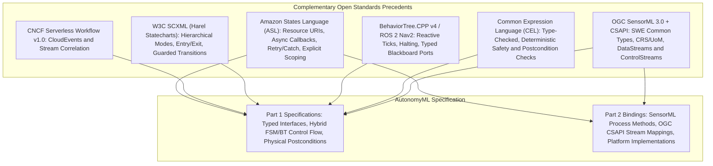
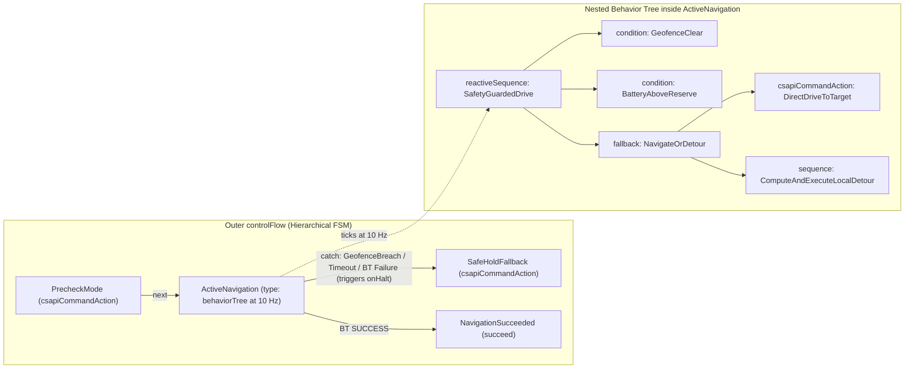
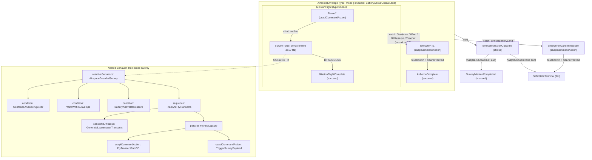

# Architectural Precedents for AutonomyML: Amazon States Language (ASL) and Complementary Open Standards

## Executive Summary

AutonomyML sits at the intersection of **Finite State Machines (FSMs)**, **Behavior Trees (BTs)**, **Typed Process Dataflow** ([OGC SensorML 3.0](https://docs.ogc.org/is/23-000/23-000.html) + SWE Common 3.0), and **Standardized System Interaction** ([OGC API - Connected Systems](https://ogcapi.ogc.org/connectedsystems/)). Because autonomous UxS capabilities combine discrete operational modes, high-rate reactive behavior, physical units/coordinate frames, and asynchronous actuation over real-world telemetry, no single existing specification covers 100% of AutonomyML's scope.

However, examining **Amazon States Language (ASL)** alongside three complementary open standards—**CNCF Serverless Workflow**, **W3C SCXML**, and **BehaviorTree.CPP v4 (ROS 2 Nav2)**—provides a battle-tested architectural blueprint for nearly every mechanism in [AutonomyML Overview.md](../../AutonomyML%20Overview.md), while **Common Expression Language (CEL)** supplies a fast, pre-flight type-checked formula language for conditions and physical postconditions.



---

## 1. Amazon States Language (ASL): What to Borrow—and What to Leave Behind

[Amazon States Language (ASL)](https://states-language.net/)—the declarative JSON specification behind AWS Step Functions—is one of the strongest industry precedents for a portable, JSON-based Finite State Machine language that cleanly separates **control flow** from **task execution**.

AutonomyML uses ASL strictly as an **architectural precedent** rather than an AWS compatibility target. That distinction lets us adopt ASL's four best structural ideas while leaving behind AWS-specific syntax baggage.

### 1.1 Abstract Task Invocation (Logical Resource URIs $\rightarrow$ Part 1 vs. Part 2 Separation)

* **In ASL:** A `Task` state never embeds imperative implementation code; instead, it references a logical `Resource` URI (an ARN) and passes structured inputs.
* **In AutonomyML:** This maps directly to the separation between **Part 1 (Specifications)** and **Part 2 (Bindings)**:
  * **Part 1** capability definitions reference symbolic capability or actuation URIs (for example, `urn:autonomyml:capability:uxs-aerial:Takeoff` or `urn:autonomyml:binding:controlstream:Navigate2D`).
  * **Part 2** bindings resolve those logical URIs to concrete system interactions—such as an OGC CSAPI `ControlStream` endpoint managed by a connector layer (e.g., `semconnect`) or an onboard SensorML computational process—without changing the portable behavior model.

### 1.2 Asynchronous Callback Pattern (`.waitForTaskToken` $\rightarrow$ Physical Postcondition Proof)

* **In ASL:** Appending `.waitForTaskToken` to a `Task` resource causes the state machine to dispatch a request and pause in that state until an external system proves completion (or until a timeout expires).
* **In AutonomyML:** Physical autonomy enforces a strict invariant: **Command Accepted $\neq$ Action Completed**. An HTTP `201 Created` or `ACCEPTED` command status on an OGC CSAPI `ControlStream` only confirms command receipt—not physical achievement. Borrowing ASL's asynchronous task lifecycle, an AutonomyML action state:
  1. Dispatches the command (`POST /controlstreams/{id}/commands`),
  2. Remains `RUNNING` while monitoring incoming `DataStream` observations, and
  3. Transitions to `next` only when a **`postcondition`** check (compiled, for example, into a `semengine` Postcondition Rule Pack) proves sustained physical completion over telemetry.

### 1.3 Structured Fault Recovery (`Retry` and `Catch` $\rightarrow$ Safe-State Transitions)

* **In ASL:** Every `Task` or `Parallel` block supports declarative retry policies and ordered `Catch` blocks that route typed runtime faults to explicit recovery states.
* **In AutonomyML:** Declarative `catch` blocks provide a clean, auditable syntax for **Approved Fault and Safe-State Plans** in domain profiles:
  * **Aerial UxS Profile:** `errors: ["AutonomyML.TelemetryStale", "AutonomyML.GeofenceBreach"]` $\rightarrow$ `next: "ExecuteRTL"` (or `EmergencyLandImmediate` on critical battery).
  * **Ground Rover Profile:** `errors: ["AutonomyML.TelemetryStale", "AutonomyML.PostconditionTimeout", "CSAPI.CommandFailed"]` $\rightarrow$ `next: "SafeHoldFallback"`.

### 1.4 Explicit Dataflow Scoping (Port Wiring Without Hidden Side Effects)

* **In ASL:** Data movement into and out of each state is explicitly scoped rather than mutated inside black-box scripts.
* **In AutonomyML:** Explicit `inputPorts` and `outputPorts` connect **SensorML typed inputs, parameters, blackboard variables, and outputs** across states and Behavior Tree nodes so data lineage remains inspectable by static validators and operator tools.

### 1.5 Where ASL Falls Short—and Why We Drop AWS Syntax Quirks

Despite its strengths as a conceptual pattern, ASL has three structural gaps for robotics/UxS and two legacy AWS syntax quirks that AutonomyML intentionally avoids:

1. **FSM-Only (No Reactive Behavior Trees):** ASL is strictly a discrete state-transition graph. It lacks reactive Behavior Tree ticks (`RUNNING`, `SUCCESS`, `FAILURE` propagating bottom-up through `reactiveSequence` and `fallback` nodes at $N\text{ Hz}$) and hierarchical preemption/halting of active subtrees.
2. **Weak Semantic Typing:** ASL passes untyped JSON values. AutonomyML relies on **OGC SensorML 3.0 / SWE Common 3.0** (and domain vocabularies such as `semvocab`) to enforce physical units of measure (`uom`), coordinate reference frames (`EPSG:4326` 2D WGS84 vs. `EPSG:4979` 3D WGS84 vs. local `NED` / `ENU` frames), quantity intervals, and observable property definitions.
3. **Discrete RPC Events vs. Continuous Telemetry Streams:** ASL is designed around discrete request/response invocations rather than continuous sensor observation streams (`/datastreams/{id}/observations`), staleness bounds (`maxObservationAgeSeconds`), and sustained physical predicates (`sustainDurationSeconds`).
4. **No AWS `PascalCase` or `"field.$"` Key-Suffix Quirks:** AWS Step Functions uses `PascalCase` keywords (`StartAt`, `States`, `ErrorEquals`, `TimeoutSeconds`) and mutates dynamic field names with a `.$` suffix (`"lat.$": "$.mission.targetLat"`), a backward-compatibility workaround that complicates JSON Schema validation. Because AutonomyML's standards home is **OGC SensorML 3.0** and **OGC API - Connected Systems**, AutonomyML uses clean, uniform **`camelCase`** (`startAt`, `states`, `inputPorts`, `outputPorts`, `postcondition`, `timeoutSeconds`, `catch`, `next`) and direct port bindings without `.$` suffixes.

---

## 2. Three Complementary Standards to Pair with ASL

Pairing ASL's conceptual state-machine patterns with three established open standards covers every concern in the [AutonomyML Overview.md](../../AutonomyML%20Overview.md) implementation table:

| Project / Standard | What It Is | Gap It Fills for AutonomyML | Mapping to AutonomyML Overview |
| :--- | :--- | :--- | :--- |
| **[CNCF Serverless Workflow (v1.0)](https://serverlessworkflow.io/)** | Vendor-neutral, open-source JSON/YAML workflow & state specification built natively around [CNCF CloudEvents](https://cloudevents.io/). | **Native Event & Stream Correlation:** Its `listen` tasks (`to.one` / `to.all` / `to.any`) filter incoming events via `with` attributes and bind them to active execution instances via `correlate` (`from` / `expect`). Models how an AutonomyML runtime correlates outgoing CSAPI `ControlStream` commands with incoming `DataStream` observation and command-status streams. | *State/Event Exchange* (Part 1) & *OGC CSAPI Interaction* |
| **[W3C SCXML (State Chart XML)](https://www.w3.org/TR/scxml/)** | The W3C Recommendation for Harel Statecharts (hierarchical and orthogonal FSMs). | **Hierarchical Modes, Lifecycles & Guards:** Defines nested `<state>` hierarchies (e.g., macro-mode `Armed` containing `Guided`, `Survey`, and `Hold` sub-modes), orthogonal `<parallel>` regions, deterministic `<onentry>` / `<onexit>` actions, and guarded transitions (`cond="..."`). Provides formal operational semantics suitable for compilation into rule engines and model checkers. | *Modes and transitions (FSMs)* & *Execution Lifecycles* |
| **[BehaviorTree.CPP (v4)](https://www.behaviortree.dev/) & [ROS 2 Nav2](https://docs.nav2.org/)** | De facto robotics Behavior Tree execution model and XML/port schema. | **Reactive Task Composition & Typed Blackboard Ports:** Defines `Sequence`, `Fallback` (Selector), `ReactiveSequence` (re-evaluates safety/precondition guards on every tick and halts `RUNNING` children immediately on failure), `StatefulActionNode` (`onStart` / `onRunning` / `onHalt`), and explicit `InputPort` / `OutputPort` bindings over a shared Blackboard—mapping 1:1 to SensorML ports. | *Reactive task composition (BTs)* & *SensorML Dataflow* |

### Deep-Dive Notes on the Complementary Trio

* **Event Correlation from CNCF Serverless Workflow:** When a vehicle executes a command over OGC CSAPI Part 2 (`OGC 23-002`), observations arrive asynchronously on `/datastreams` while command lifecycle updates (`ACCEPTED`, `EXECUTING`, `COMPLETED`, `FAILED`) arrive on `/commands/{cmdId}/status`. Serverless Workflow's declarative `correlate` pattern demonstrates how to bind `systemId`, `commandId`, and temporal freshness constraints without custom imperative glue code.
* **Hierarchical Mode Invariants from W3C SCXML:** Flat FSMs suffer from transition explosion: if multiple mission states share the same `GeofenceBreach` and `TelemetryStale` recovery transitions, every state in a flat graph has to repeat those `catch` handlers. Borrowing SCXML's hierarchical compound states allows an enclosing parent mode to declare mode-wide `<onexit>` cleanup and fault `catch` transitions once, inherited automatically by nested states. Furthermore, robotics verification toolchains (such as the EU CONVINCE / AS2FM framework) already demonstrate translating hybrid BT.CPP + SCXML models into formal verification targets.
* **Preemption (`onHalt`) and Blackboard Ports from BT.CPP v4:** Unlike fire-and-forget workflow tasks, physical robot actions must support clean preemption when a higher-priority condition changes mid-execution. BT.CPP's `StatefulActionNode` lifecycle (`onStart` $\rightarrow$ `onRunning` $\rightarrow$ `onHalt`) gives AutonomyML a crisp contract for cancelling or superseding an active CSAPI `ControlStream` command whenever a parent `reactiveSequence` guard fails or an enclosing FSM `catch` triggers.

---

## 3. Architectural Recommendation: CEL for Deterministic Conditions & Postconditions

JSON by itself only stores data—it cannot express math or boolean logic. Yet Part 1 capability files need concise, portable one-line checks in three places:

1. **Behavior Tree `condition` guards:** *"Is battery above 30% and wind speed under 12 m/s?"*
2. **Physical `postcondition` proofs:** *"Is the rover within 1.5 m of the target waypoint?"* or *"Is the drone below 0.2 m AGL and disarmed?"*
3. **FSM `choice` branch conditions:** *"Did this mission enter Return-to-Launch because of a recorded fault?"*

Embedding general-purpose scripting (Python, JavaScript) is unsafe because scripts can hang in loops, mutate state, or behave differently across runtimes. Among open-source expression languages—primarily **JSONata** (adopted by AWS Step Functions) and **[Common Expression Language (CEL)](https://cel.dev/)** (used across Kubernetes, Envoy, and safety/policy engines)—**CEL is strongly recommended for AutonomyML**:

| Criterion | JSONata (AWS Step Functions Choice) | CEL — Common Expression Language (**Recommended**) |
| :--- | :--- | :--- |
| **Pre-flight type safety** | Dynamically/loosely typed; a misspelled sensor field often evaluates silently to "nothing" (`undefined` / `false`) at runtime instead of raising a pre-flight validation error. | **Statically type-checked at load time** against SensorML / SWE Common port types—catching unit/type mismatches or field typos on the ground before the vehicle ever arms. |
| **Real-time tick guarantees** | Designed for expressive JSON document reshaping (includes higher-order functions/recursion unless restricted). | **Non-Turing-complete by design** (no unbounded loops, no recursion, zero side effects). Every expression is guaranteed to evaluate deterministically in microseconds at $10\text{–}50\text{ Hz}$ tick rates. |
| **Readability for robotics engineers** | Uses specialized query syntax (`$`, `~>`, empty-sequence rules) tailored to JSON transformation. | Uses standard C/Python-style boolean and math syntax (`batterySoc >= 30.0 && !observation.armed`, `has(blackboard.lastFault)`). |
| **Compilation to `semengine` rules** | Requires restricting a broad transformation grammar. | Parses into a tiny, typed Abstract Syntax Tree (AST) with pluggable domain functions (`distance2D`, `distance3D`, `withinPolygon`, `withinVolume3D`) that compiles 1:1 into `semengine` Rule Packs. |

---

## 4. Side-by-Side Comparison: Standard ASL vs. OGC-Native AutonomyML

Compare a raw Amazon States Language `Task` definition (with AWS `PascalCase` and `.$` parameter suffixes) against an AutonomyML capability that keeps ASL's structural clarity while adopting **OGC-native `camelCase`**, **clean `inputPorts`/`outputPorts` wiring**, **SensorML 3.0 / SWE Common 3.0 types**, **CEL postconditions**, and **Part 2 CSAPI bindings**.

### 4.1 Standard Amazon States Language (ASL Reference)

```json
{
  "StartAt": "NavigateToWaypoint",
  "States": {
    "NavigateToWaypoint": {
      "Type": "Task",
      "Resource": "arn:aws:states:::lambda:invoke.waitForTaskToken",
      "Parameters": {
        "lat.$": "$.mission.targetLat",
        "lon.$": "$.mission.targetLon"
      },
      "TimeoutSeconds": 60,
      "Catch": [
        {
          "ErrorEquals": ["States.Timeout", "NavigationFault"],
          "Next": "SafeHoldState"
        }
      ],
      "Next": "VerifyArrival"
    },
    "VerifyArrival": {
      "Type": "Succeed"
    },
    "SafeHoldState": {
      "Type": "Fail",
      "Error": "NavigationAborted",
      "Cause": "Waypoint navigation timed out or faulted."
    }
  }
}
```

### 4.2 AutonomyML Part 1 Equivalent (`WaypointNavigation` — OGC `camelCase` + CEL + SensorML Ports)

```json
{
  "autonomyMLVersion": "0.1.0",
  "kind": "CapabilitySpecification",
  "expressionLanguage": "cel",
  "profile": "urn:semvocab:profile:uxs-ground-rover:1.0",
  "capabilityId": "urn:autonomyml:capability:uxs-ground-rover:WaypointNavigation:0.1.0",
  "interface": {
    "comment": "SensorML 3.0 / SWE Common 3.0 aligned typed ports (validated against profile vocabulary)",
    "inputs": {
      "targetWaypoint": {
        "type": "Vector",
        "definition": "http://www.opengis.net/def/property/OGC/0/PlatformLocation",
        "referenceFrame": "http://www.opengis.net/def/crs/EPSG/0/4326",
        "coordinates": [
          { "name": "lat", "type": "Quantity", "axisID": "Lat", "uom": { "code": "deg" } },
          { "name": "lon", "type": "Quantity", "axisID": "Lon", "uom": { "code": "deg" } }
        ]
      }
    },
    "parameters": {
      "arrivalRadius": {
        "type": "Quantity",
        "definition": "urn:autonomyml:def:parameter:ArrivalAcceptanceRadius",
        "uom": { "code": "m" },
        "value": 1.5
      }
    },
    "outputs": {
      "achievedPosition": {
        "type": "Vector",
        "referenceFrame": "http://www.opengis.net/def/crs/EPSG/0/4326",
        "coordinates": [
          { "name": "lat", "type": "Quantity", "axisID": "Lat", "uom": { "code": "deg" } },
          { "name": "lon", "type": "Quantity", "axisID": "Lon", "uom": { "code": "deg" } }
        ]
      }
    }
  },
  "controlFlow": {
    "startAt": "DriveToWaypoint",
    "states": {
      "DriveToWaypoint": {
        "type": "csapiCommandAction",
        "resource": "urn:autonomyml:binding:controlstream:Navigate2D",
        "inputPorts": {
          "target": "interface.inputs.targetWaypoint"
        },
        "outputPorts": {
          "finalPosition": "interface.outputs.achievedPosition"
        },
        "postcondition": {
          "observationStream": "urn:autonomyml:binding:datastream:VehiclePose",
          "maxObservationAgeSeconds": 1.0,
          "condition": "distance2D(observation.position, interface.inputs.targetWaypoint) <= interface.parameters.arrivalRadius",
          "sustainDurationSeconds": 2.0
        },
        "timeoutSeconds": 120,
        "catch": [
          {
            "errors": [
              "AutonomyML.TelemetryStale",
              "AutonomyML.PostconditionTimeout",
              "CSAPI.CommandFailed"
            ],
            "next": "SafeHoldFallback"
          }
        ],
        "next": "HoldAtWaypoint"
      },
      "HoldAtWaypoint": {
        "type": "succeed"
      },
      "SafeHoldFallback": {
        "type": "csapiCommandAction",
        "resource": "urn:autonomyml:binding:controlstream:HoldPosition",
        "postcondition": {
          "observationStream": "urn:autonomyml:binding:datastream:VehicleVelocity",
          "maxObservationAgeSeconds": 1.0,
          "condition": "observation.groundSpeed <= 0.1",
          "sustainDurationSeconds": 3.0
        },
        "timeoutSeconds": 30,
        "next": "SafeHoldTerminated"
      },
      "SafeHoldTerminated": {
        "type": "fail",
        "error": "AutonomyML.SafeStateEngaged",
        "cause": "Vehicle transitioned to verified zero-velocity hold after navigation fault."
      }
    }
  }
}
```

> **Note on SensorML 3.0 (OGC 23-000) Encoding Alignment:** In OGC SensorML 3.0 / SWE Common 3.0 JSON schemas, `Quantity` units of measure use `"uom": { "code": "deg" }` (UCUM code) or `"uom": { "href": "..." }`, and spatial vectors declare `"type": "Vector"` with an explicit `"referenceFrame"` URI. Everything outside SWE Common's formal type names (`Vector`, `Quantity`, `DataRecord`, `DataArray`, `Count`) uses uniform `camelCase` with zero `.$` key mutations.

### 4.3 Companion AutonomyML Part 2 Binding (Concrete OGC CSAPI Resolution)

Because `DriveToWaypoint` and `SafeHoldFallback` only reference logical `urn:autonomyml:binding:*` URIs, two completely different ground rovers (e.g., a ROS 2 Nav2 UGV vs. an ArduRover/MAVLink UGV exposed via OGC CSAPI) can satisfy the **exact same Part 1 capability** by supplying their own **Part 2 Binding**:

```json
{
  "autonomyMLVersion": "0.1.0",
  "kind": "CapabilityBinding",
  "capabilityRef": "urn:autonomyml:capability:uxs-ground-rover:WaypointNavigation:0.1.0",
  "targetSystem": "urn:ogc:def:system:ugv-alpha-01",
  "csapiBaseUrl": "https://csapi.example.org/ogcapi",
  "controlStreamBindings": {
    "urn:autonomyml:binding:controlstream:Navigate2D": {
      "controlStreamPath": "/controlstreams/ugv-alpha-01-nav2d",
      "commandSchema": "urn:ogc:def:csapi:command:GoalPose2D",
      "onHaltAction": {
        "method": "POST",
        "controlStreamPath": "/controlstreams/ugv-alpha-01-hold",
        "payload": { "mode": "BRAKE_HOLD" }
      }
    },
    "urn:autonomyml:binding:controlstream:HoldPosition": {
      "controlStreamPath": "/controlstreams/ugv-alpha-01-hold",
      "commandSchema": "urn:ogc:def:csapi:command:HoldPosition"
    }
  },
  "dataStreamBindings": {
    "urn:autonomyml:binding:datastream:VehiclePose": {
      "dataStreamPath": "/datastreams/ugv-alpha-01-gnss-ins-pose",
      "expectedRateHz": 10.0
    },
    "urn:autonomyml:binding:datastream:VehicleVelocity": {
      "dataStreamPath": "/datastreams/ugv-alpha-01-twist",
      "expectedRateHz": 10.0
    }
  }
}
```

---

## 5. Unifying FSMs and Behavior Trees Across Domain Profiles

A central architectural question for AutonomyML is how the **FSM** row (*"Modes and transitions"*) and the **Behavior Tree** row (*"Reactive task composition"*) in [AutonomyML Overview.md](../../AutonomyML%20Overview.md) fit together cleanly—and how that unified schema adapts across distinct **Layer 2 Domain Profiles** such as **Ground Rover** and **Aerial UxS**.

### 5.1 Architectural Principle: Mode Supervision (FSM) + Reactive Execution (BT)

In safety-critical robotics, FSMs and Behavior Trees are complementary rather than competing formalisms:

* **Hierarchical FSMs excel at Macro-Modes and Lifecycle Governance:** System modes (`Takeoff`, `Survey`, `ActiveNavigation`, `SafeHoldFallback`, `ExecuteRTL`, `EmergencyLandImmediate`) have mutually exclusive operational envelopes, mode-entry/exit invariants (SCXML `<onentry>` / `<onexit>`), and regulatory safe-state fault transitions (`catch`).
* **Behavior Trees excel at High-Rate Reactive Task Composition inside an Active Mode:** Within an active mode like `ActiveNavigation` or `Survey`, the vehicle must continuously evaluate environmental conditions (geofence clearance, wind limits, obstacle proximity, battery reserves) at $N\text{ Hz}$ while sequencing local actions and fallbacks.

AutonomyML unifies both formalisms through **bidirectional, typed composition** over a shared **SensorML Blackboard**:

1. **FSM Hosting a Behavior Tree (`"type": "behaviorTree"` State):** Any state in an AutonomyML `controlFlow` state machine can declare `"type": "behaviorTree"` with an explicit `tickRateHz` and `root` node (`reactiveSequence`, `sequence`, `fallback`, `reactiveFallback`, `parallel`).
   * `SUCCESS` at the BT root transitions the enclosing FSM state to `next`.
   * `RUNNING` at the BT root keeps the FSM in the current state for the next tick (subject to `timeoutSeconds`).
   * `FAILURE` at the BT root raises a typed fault (`AutonomyML.BehaviorTreeFailed` or a specific guard `failureError` such as `AutonomyML.GeofenceBreach`) that routes cleanly through the enclosing state or parent mode's `catch` block—calling `onHalt` on any active leaf action first.
2. **Behavior Tree Invoking a Sub-Capability (`"nodeType": "invokeCapability"` Leaf):** Conversely, any BT leaf action can invoke another reusable AutonomyML capability URI whose internal implementation may itself be an FSM, a SensorML `AggregateProcess`, or another BT—returning `RUNNING` until that sub-capability's physical `postcondition` succeeds.
3. **Optional SCXML-Style Parent Modes (`"type": "mode"`) & Fault Bubbling:** Simple single-stage capabilities (like the Ground Rover examples) can keep a flat `states` map, whereas multi-stage capabilities (like the Aerial UxS example) can group child states inside parent `"type": "mode"` blocks with `modeInvariants` and shared `catch` handlers. Just like nested `try / catch` scopes, any fault not handled by a child state automatically halts the active action and bubbles up to its enclosing parent mode—eliminating copy-pasted `catch` blocks across flight phases.



### 5.2 Hybrid Example A — Ground Rover Profile (`GuardedWaypointNavigation`)

The example below extends the Ground Rover `WaypointNavigation` baseline into a hybrid capability where the outer FSM governs lifecycle and zero-velocity safe-hold recovery while the `ActiveNavigation` state ticks a reactive Behavior Tree at `10 Hz` over SensorML-typed Blackboard variables using CEL conditions:

```json
{
  "autonomyMLVersion": "0.1.0",
  "kind": "CapabilitySpecification",
  "expressionLanguage": "cel",
  "profile": "urn:semvocab:profile:uxs-ground-rover:1.0",
  "capabilityId": "urn:autonomyml:capability:uxs-ground-rover:GuardedWaypointNavigation:0.1.0",
  "interface": {
    "inputs": {
      "targetWaypoint": {
        "type": "Vector",
        "referenceFrame": "http://www.opengis.net/def/crs/EPSG/0/4326",
        "coordinates": [
          { "name": "lat", "type": "Quantity", "axisID": "Lat", "uom": { "code": "deg" } },
          { "name": "lon", "type": "Quantity", "axisID": "Lon", "uom": { "code": "deg" } }
        ]
      },
      "geofencePolygon": {
        "type": "DataRecord",
        "definition": "urn:autonomyml:def:geometry:InclusionCorridor2D"
      }
    },
    "parameters": {
      "arrivalRadius": { "type": "Quantity", "uom": { "code": "m" }, "value": 1.5 },
      "minReserveSoc": { "type": "Quantity", "uom": { "code": "%" }, "value": 20.0 }
    }
  },
  "blackboard": {
    "comment": "Shared SensorML-typed state populated from CSAPI DataStreams and internal process ports",
    "vehiclePose": {
      "sourceStream": "urn:autonomyml:binding:datastream:VehiclePose",
      "maxAgeSeconds": 0.5,
      "type": "Vector",
      "referenceFrame": "http://www.opengis.net/def/crs/EPSG/0/4326"
    },
    "batterySoc": {
      "sourceStream": "urn:autonomyml:binding:datastream:BatteryStatus",
      "maxAgeSeconds": 2.0,
      "type": "Quantity",
      "uom": { "code": "%" }
    },
    "detourWaypoint": {
      "type": "Vector",
      "referenceFrame": "http://www.opengis.net/def/crs/EPSG/0/4326"
    }
  },
  "controlFlow": {
    "startAt": "ActiveNavigation",
    "states": {
      "ActiveNavigation": {
        "type": "behaviorTree",
        "tickRateHz": 10.0,
        "timeoutSeconds": 180,
        "root": {
          "nodeType": "reactiveSequence",
          "name": "SafetyGuardedDrive",
          "children": [
            {
              "nodeType": "condition",
              "name": "GeofenceClear",
              "expression": "withinPolygon(blackboard.vehiclePose, interface.inputs.geofencePolygon)",
              "failureError": "AutonomyML.GeofenceBreach"
            },
            {
              "nodeType": "condition",
              "name": "BatteryAboveReserve",
              "expression": "blackboard.batterySoc >= interface.parameters.minReserveSoc",
              "failureError": "AutonomyML.LowBatteryReserve"
            },
            {
              "nodeType": "fallback",
              "name": "NavigateOrDetour",
              "children": [
                {
                  "nodeType": "csapiCommandAction",
                  "name": "DirectDriveToTarget",
                  "resource": "urn:autonomyml:binding:controlstream:Navigate2D",
                  "inputPorts": {
                    "target": "interface.inputs.targetWaypoint"
                  },
                  "postcondition": {
                    "observationStream": "urn:autonomyml:binding:datastream:VehiclePose",
                    "maxObservationAgeSeconds": 0.5,
                    "condition": "distance2D(observation.position, interface.inputs.targetWaypoint) <= interface.parameters.arrivalRadius",
                    "sustainDurationSeconds": 2.0
                  }
                },
                {
                  "nodeType": "sequence",
                  "name": "ComputeAndExecuteLocalDetour",
                  "children": [
                    {
                      "nodeType": "sensorMLProcess",
                      "name": "ComputeLocalDetour",
                      "process": "urn:autonomyml:process:LocalObstacleAvoidancePlanner",
                      "inputPorts": {
                        "currentPose": "blackboard.vehiclePose",
                        "goal": "interface.inputs.targetWaypoint"
                      },
                      "outputPorts": {
                        "detourGoal": "blackboard.detourWaypoint"
                      }
                    },
                    {
                      "nodeType": "csapiCommandAction",
                      "name": "DriveDetourSegment",
                      "resource": "urn:autonomyml:binding:controlstream:Navigate2D",
                      "inputPorts": {
                        "target": "blackboard.detourWaypoint"
                      },
                      "postcondition": {
                        "observationStream": "urn:autonomyml:binding:datastream:VehiclePose",
                        "maxObservationAgeSeconds": 0.5,
                        "condition": "distance2D(observation.position, blackboard.detourWaypoint) <= interface.parameters.arrivalRadius",
                        "sustainDurationSeconds": 1.0
                      }
                    }
                  ]
                }
              ]
            }
          ]
        },
        "catch": [
          {
            "errors": [
              "AutonomyML.GeofenceBreach",
              "AutonomyML.LowBatteryReserve",
              "AutonomyML.TelemetryStale",
              "AutonomyML.PostconditionTimeout",
              "AutonomyML.BehaviorTreeFailed"
            ],
            "next": "SafeHoldFallback"
          }
        ],
        "next": "NavigationSucceeded"
      },
      "NavigationSucceeded": {
        "type": "succeed"
      },
      "SafeHoldFallback": {
        "type": "csapiCommandAction",
        "resource": "urn:autonomyml:binding:controlstream:HoldPosition",
        "postcondition": {
          "observationStream": "urn:autonomyml:binding:datastream:VehicleVelocity",
          "maxObservationAgeSeconds": 1.0,
          "condition": "observation.groundSpeed <= 0.1",
          "sustainDurationSeconds": 3.0
        },
        "timeoutSeconds": 30,
        "next": "SafeHoldActive"
      },
      "SafeHoldActive": {
        "type": "fail",
        "error": "AutonomyML.SafeStateEngaged",
        "cause": "Reactive safety guard or navigation timeout triggered verified hold state."
      }
    }
  }
}
```

### 5.3 Hybrid Example B — Aerial UxS Profile (`Takeoff`, `Survey`, and `ExecuteRTL` with Parent Modes)

Placing an **Aerial UxS** capability (`urn:semvocab:profile:uxs-aerial:1.0`) alongside the flat Ground Rover example highlights both **Layer 2 Domain Profile** specialization and **SCXML-style parent mode grouping (`"type": "mode"`)**:

1. **3D Coordinate Frames & Explicit Vertical Semantics:** Unlike a 2D rover (`EPSG:4326`), aerial vehicles require 3D WGS84 coordinates (`http://www.opengis.net/def/crs/EPSG/0/4979` with ellipsoidal height) alongside explicit above-ground-level (`AGL`) clearance quantities so altitude datums are never conflated.
2. **Concentric Parent Modes (`AirborneEnvelope` $\supset$ `MissionFlight`) Eliminate Repeated `catch` Blocks:** Instead of copy-pasting emergency battery and telemetry `catch` handlers onto every individual flight phase, the capability wraps airborne states in two concentric `"type": "mode"` scopes:
   * **`MissionFlight` (inner parent mode)** wraps `Takeoff` and `Survey`—neither of which needs any `catch` block of its own. Any recoverable envelope or mission fault (`GeofenceBreach`, `WindLimitExceeded`, `RtlBatteryReserve`, `TelemetryStale`, `PostconditionTimeout`, `BehaviorTreeFailed`, `CSAPI.CommandFailed`) bubbles up to `MissionFlight`'s single `catch` handler, runs `onHalt` (`LOITER_3D_HOLD` + camera `STOP`), records the fault in `blackboard.lastFault`, and transitions to **`ExecuteRTL`**.
   * **`AirborneEnvelope` (outer parent mode)** wraps both `MissionFlight` and `ExecuteRTL`, continuously enforces a mode-wide `BatteryAboveCriticalLand` invariant (`modeInvariants`), and catches `AutonomyML.CriticalBatteryLand`—or any fault occurring during `ExecuteRTL` itself—routing directly to **`EmergencyLandImmediate`**.
3. **Unified CEL Outcome Disambiguation:** Because `ExecuteRTL` serves as both the nominal post-survey return and the Tier-1 fault recovery path, `EvaluateMissionOutcome` (`"type": "choice"`) checks `has(blackboard.lastFault)` in CEL to distinguish nominal survey completion (`succeed`) from a safe fault-induced recovery (`fail`).



#### Part 1 Capability Specification (`TakeoffSurveyAndRTL`)

```json
{
  "autonomyMLVersion": "0.1.0",
  "kind": "CapabilitySpecification",
  "expressionLanguage": "cel",
  "profile": "urn:semvocab:profile:uxs-aerial:1.0",
  "capabilityId": "urn:autonomyml:capability:uxs-aerial:TakeoffSurveyAndRTL:0.1.0",
  "interface": {
    "comment": "3D spatial frames (EPSG:4979) and explicit AGL vertical clearance quantities",
    "inputs": {
      "homePosition": {
        "type": "Vector",
        "definition": "http://www.opengis.net/def/property/OGC/0/PlatformLocation",
        "referenceFrame": "http://www.opengis.net/def/crs/EPSG/0/4979",
        "coordinates": [
          { "name": "lat", "type": "Quantity", "axisID": "Lat", "uom": { "code": "deg" } },
          { "name": "lon", "type": "Quantity", "axisID": "Lon", "uom": { "code": "deg" } },
          { "name": "ellipsoidalHeight", "type": "Quantity", "axisID": "h", "uom": { "code": "m" } }
        ]
      },
      "surveyPolygon": {
        "type": "DataRecord",
        "definition": "urn:autonomyml:def:geometry:SurveyAreaPolygon2D"
      },
      "airspaceVolume": {
        "type": "DataRecord",
        "definition": "urn:autonomyml:def:geometry:InclusionAirspaceVolume3D"
      },
      "surveyAltitudeAgl": {
        "type": "Quantity",
        "definition": "urn:autonomyml:def:property:AltitudeAboveGroundLevel",
        "uom": { "code": "m" }
      }
    },
    "parameters": {
      "rtlAltitudeAgl": { "type": "Quantity", "uom": { "code": "m" }, "value": 45.0 },
      "altitudeTolerance": { "type": "Quantity", "uom": { "code": "m" }, "value": 1.0 },
      "waypointRadius3D": { "type": "Quantity", "uom": { "code": "m" }, "value": 2.5 },
      "sensorSwathWidth": { "type": "Quantity", "uom": { "code": "m" }, "value": 30.0 },
      "maxWindSpeed": { "type": "Quantity", "uom": { "code": "m/s" }, "value": 12.0 },
      "rtlReserveSoc": { "type": "Quantity", "uom": { "code": "%" }, "value": 30.0 },
      "criticalLandSoc": { "type": "Quantity", "uom": { "code": "%" }, "value": 15.0 }
    },
    "outputs": {
      "capturedImageCount": {
        "type": "Count",
        "definition": "urn:autonomyml:def:property:PayloadCaptureCount"
      }
    }
  },
  "blackboard": {
    "vehiclePose3D": {
      "sourceStream": "urn:autonomyml:binding:datastream:VehicleAirPose",
      "maxAgeSeconds": 0.5,
      "type": "Vector",
      "referenceFrame": "http://www.opengis.net/def/crs/EPSG/0/4979"
    },
    "windSpeed": {
      "sourceStream": "urn:autonomyml:binding:datastream:WindEstimate",
      "maxAgeSeconds": 2.0,
      "type": "Quantity",
      "uom": { "code": "m/s" }
    },
    "batterySoc": {
      "sourceStream": "urn:autonomyml:binding:datastream:BatteryStatus",
      "maxAgeSeconds": 1.0,
      "type": "Quantity",
      "uom": { "code": "%" }
    },
    "transectPath": {
      "type": "DataArray",
      "definition": "urn:autonomyml:def:trajectory:WaypointArray3D"
    },
    "lastFault": {
      "type": "DataRecord",
      "definition": "urn:autonomyml:def:diagnostics:FaultRecord"
    }
  },
  "controlFlow": {
    "startAt": "AirborneEnvelope",
    "states": {
      "AirborneEnvelope": {
        "type": "mode",
        "modeInvariants": [
          {
            "name": "BatteryAboveCriticalLand",
            "condition": "blackboard.batterySoc >= interface.parameters.criticalLandSoc",
            "failureError": "AutonomyML.CriticalBatteryLand"
          }
        ],
        "startAt": "MissionFlight",
        "states": {
          "MissionFlight": {
            "type": "mode",
            "startAt": "Takeoff",
            "states": {
              "Takeoff": {
                "type": "csapiCommandAction",
                "resource": "urn:autonomyml:binding:controlstream:VerticalTakeoff",
                "inputPorts": {
                  "targetAltitudeAgl": "interface.inputs.surveyAltitudeAgl"
                },
                "postcondition": {
                  "observationStream": "urn:autonomyml:binding:datastream:VehicleAirPose",
                  "maxObservationAgeSeconds": 0.5,
                  "condition": "abs(observation.altitudeAgl - interface.inputs.surveyAltitudeAgl) <= interface.parameters.altitudeTolerance && abs(observation.verticalSpeed) <= 0.3",
                  "sustainDurationSeconds": 2.0
                },
                "timeoutSeconds": 60,
                "next": "Survey"
              },
              "Survey": {
                "type": "behaviorTree",
                "tickRateHz": 10.0,
                "timeoutSeconds": 900,
                "root": {
                  "nodeType": "reactiveSequence",
                  "name": "AirspaceGuardedSurvey",
                  "children": [
                    {
                      "nodeType": "condition",
                      "name": "GeofenceAndCeilingClear",
                      "expression": "withinVolume3D(blackboard.vehiclePose3D, interface.inputs.airspaceVolume)",
                      "failureError": "AutonomyML.GeofenceBreach"
                    },
                    {
                      "nodeType": "condition",
                      "name": "WindWithinEnvelope",
                      "expression": "blackboard.windSpeed <= interface.parameters.maxWindSpeed",
                      "failureError": "AutonomyML.WindLimitExceeded"
                    },
                    {
                      "nodeType": "condition",
                      "name": "BatteryAboveRtlReserve",
                      "expression": "blackboard.batterySoc >= interface.parameters.rtlReserveSoc",
                      "failureError": "AutonomyML.RtlBatteryReserve"
                    },
                    {
                      "nodeType": "sequence",
                      "name": "PlanAndFlyTransects",
                      "children": [
                        {
                          "nodeType": "sensorMLProcess",
                          "name": "GenerateLawnmowerTransects",
                          "process": "urn:autonomyml:process:CoveragePathGenerator3D",
                          "inputPorts": {
                            "polygon": "interface.inputs.surveyPolygon",
                            "altitudeAgl": "interface.inputs.surveyAltitudeAgl",
                            "swathWidth": "interface.parameters.sensorSwathWidth"
                          },
                          "outputPorts": {
                            "waypoints": "blackboard.transectPath"
                          }
                        },
                        {
                          "nodeType": "parallel",
                          "name": "FlyAndCapture",
                          "successThreshold": 2,
                          "failureThreshold": 1,
                          "children": [
                            {
                              "nodeType": "csapiCommandAction",
                              "name": "FlyTransectPath3D",
                              "resource": "urn:autonomyml:binding:controlstream:FollowTrajectory3D",
                              "inputPorts": {
                                "waypoints": "blackboard.transectPath"
                              },
                              "postcondition": {
                                "observationStream": "urn:autonomyml:binding:datastream:VehicleAirPose",
                                "maxObservationAgeSeconds": 0.5,
                                "condition": "distance3D(observation.position, last(blackboard.transectPath)) <= interface.parameters.waypointRadius3D",
                                "sustainDurationSeconds": 1.5
                              }
                            },
                            {
                              "nodeType": "csapiCommandAction",
                              "name": "TriggerSurveyPayload",
                              "resource": "urn:autonomyml:binding:controlstream:CameraIntervalCapture",
                              "inputPorts": {
                                "surveyArea": "interface.inputs.surveyPolygon"
                              },
                              "outputPorts": {
                                "captureCount": "interface.outputs.capturedImageCount"
                              },
                              "postcondition": {
                                "observationStream": "urn:autonomyml:binding:datastream:PayloadStatus",
                                "maxObservationAgeSeconds": 1.0,
                                "condition": "observation.transectCaptureComplete",
                                "sustainDurationSeconds": 0.5
                              }
                            }
                          ]
                        }
                      ]
                    }
                  ]
                },
                "next": "MissionFlightComplete"
              },
              "MissionFlightComplete": {
                "type": "succeed"
              }
            },
            "catch": [
              {
                "errors": [
                  "AutonomyML.GeofenceBreach",
                  "AutonomyML.WindLimitExceeded",
                  "AutonomyML.RtlBatteryReserve",
                  "AutonomyML.TelemetryStale",
                  "AutonomyML.PostconditionTimeout",
                  "AutonomyML.BehaviorTreeFailed",
                  "CSAPI.CommandFailed"
                ],
                "faultTarget": "blackboard.lastFault",
                "next": "ExecuteRTL"
              }
            ],
            "next": "ExecuteRTL"
          },
          "ExecuteRTL": {
            "type": "csapiCommandAction",
            "resource": "urn:autonomyml:binding:controlstream:ReturnToLaunch",
            "inputPorts": {
              "home": "interface.inputs.homePosition",
              "minimumRtlAltitudeAgl": "interface.parameters.rtlAltitudeAgl"
            },
            "postcondition": {
              "observationStream": "urn:autonomyml:binding:datastream:VehicleAirPose",
              "maxObservationAgeSeconds": 0.5,
              "condition": "distance2D(observation.position, interface.inputs.homePosition) <= 2.0 && observation.altitudeAgl <= 0.2 && !observation.armed",
              "sustainDurationSeconds": 2.0
            },
            "timeoutSeconds": 300,
            "next": "AirborneComplete"
          },
          "AirborneComplete": {
            "type": "succeed"
          }
        },
        "catch": [
          {
            "errors": [
              "AutonomyML.CriticalBatteryLand",
              "AutonomyML.TelemetryStale",
              "AutonomyML.PostconditionTimeout",
              "CSAPI.CommandFailed"
            ],
            "faultTarget": "blackboard.lastFault",
            "next": "EmergencyLandImmediate"
          }
        ],
        "next": "EvaluateMissionOutcome"
      },
      "EmergencyLandImmediate": {
        "type": "csapiCommandAction",
        "resource": "urn:autonomyml:binding:controlstream:LandImmediate",
        "postcondition": {
          "observationStream": "urn:autonomyml:binding:datastream:VehicleAirPose",
          "maxObservationAgeSeconds": 0.5,
          "condition": "observation.altitudeAgl <= 0.2 && !observation.armed",
          "sustainDurationSeconds": 2.0
        },
        "timeoutSeconds": 120,
        "next": "SafeStateTerminal"
      },
      "EvaluateMissionOutcome": {
        "type": "choice",
        "choices": [
          {
            "condition": "has(blackboard.lastFault)",
            "next": "SafeStateTerminal"
          }
        ],
        "default": "SurveyMissionCompleted"
      },
      "SurveyMissionCompleted": {
        "type": "succeed"
      },
      "SafeStateTerminal": {
        "type": "fail",
        "error": "AutonomyML.SafeStateEngaged",
        "cause": "Mission aborted cleanly via verified ReturnToLaunch or EmergencyLandImmediate."
      }
    }
  }
}
```

#### Companion Part 2 Binding (`CapabilityBinding` for an Aerial Platform)

```json
{
  "autonomyMLVersion": "0.1.0",
  "kind": "CapabilityBinding",
  "capabilityRef": "urn:autonomyml:capability:uxs-aerial:TakeoffSurveyAndRTL:0.1.0",
  "targetSystem": "urn:ogc:def:system:uav-quad-04",
  "csapiBaseUrl": "https://csapi.example.org/ogcapi",
  "processBindings": {
    "urn:autonomyml:process:CoveragePathGenerator3D": {
      "sensorMLProcessUri": "urn:ogc:def:process:semautonomy:BoustrophedonPlanner:1.2"
    }
  },
  "controlStreamBindings": {
    "urn:autonomyml:binding:controlstream:VerticalTakeoff": {
      "controlStreamPath": "/controlstreams/uav-quad-04-takeoff",
      "commandSchema": "urn:ogc:def:csapi:command:TakeoffAGL"
    },
    "urn:autonomyml:binding:controlstream:FollowTrajectory3D": {
      "controlStreamPath": "/controlstreams/uav-quad-04-trajectory3d",
      "commandSchema": "urn:ogc:def:csapi:command:WaypointTrajectory3D",
      "onHaltAction": {
        "method": "POST",
        "controlStreamPath": "/controlstreams/uav-quad-04-loiter",
        "payload": { "mode": "LOITER_3D_HOLD" }
      }
    },
    "urn:autonomyml:binding:controlstream:CameraIntervalCapture": {
      "controlStreamPath": "/controlstreams/uav-quad-04-eo-camera",
      "commandSchema": "urn:ogc:def:csapi:command:DistanceIntervalTrigger",
      "onHaltAction": {
        "method": "POST",
        "controlStreamPath": "/controlstreams/uav-quad-04-eo-camera",
        "payload": { "trigger": "STOP" }
      }
    },
    "urn:autonomyml:binding:controlstream:ReturnToLaunch": {
      "controlStreamPath": "/controlstreams/uav-quad-04-rtl",
      "commandSchema": "urn:ogc:def:csapi:command:ReturnToLaunch"
    },
    "urn:autonomyml:binding:controlstream:LandImmediate": {
      "controlStreamPath": "/controlstreams/uav-quad-04-land",
      "commandSchema": "urn:ogc:def:csapi:command:LandVertical"
    }
  },
  "dataStreamBindings": {
    "urn:autonomyml:binding:datastream:VehicleAirPose": {
      "dataStreamPath": "/datastreams/uav-quad-04-air-pose",
      "expectedRateHz": 20.0
    },
    "urn:autonomyml:binding:datastream:WindEstimate": {
      "dataStreamPath": "/datastreams/uav-quad-04-wind",
      "expectedRateHz": 2.0
    },
    "urn:autonomyml:binding:datastream:BatteryStatus": {
      "dataStreamPath": "/datastreams/uav-quad-04-battery",
      "expectedRateHz": 5.0
    },
    "urn:autonomyml:binding:datastream:PayloadStatus": {
      "dataStreamPath": "/datastreams/uav-quad-04-eo-camera-status",
      "expectedRateHz": 5.0
    }
  }
}
```

### 5.4 Cross-Profile Comparison: Ground Rover vs. Aerial UxS

Comparing both examples side by side demonstrates how **Layer 1 (Core Composition Language)** supports both simple flat capabilities and nested mode hierarchies while **Layer 2 (Domain Profiles)** and **Part 2 (Bindings)** capture the physical invariants of each vehicle class:

| Architectural Dimension | Ground Rover Profile (`uxs-ground-rover:1.0`) | Aerial UxS Profile (`uxs-aerial:1.0`) |
| :--- | :--- | :--- |
| **Spatial Reference Frame (`interface`)** | 2D geographic `EPSG:4326` (`lat`, `lon`) + planar inclusion polygon. | 3D geographic `EPSG:4979` (`lat`, `lon`, `ellipsoidalHeight`) + explicit `AGL` altitude & 3D airspace volume. |
| **FSM Structure (`controlFlow`)** | Simple flat `states` (`ActiveNavigation` $\rightarrow$ `NavigationSucceeded` or `SafeHoldFallback`). | Nested SCXML-style parent modes: `AirborneEnvelope` (`modeInvariants`) $\supset$ `MissionFlight` (`Takeoff` $\rightarrow$ `Survey`) + `ExecuteRTL`, with zero repeated `catch` blocks on child states. |
| **Nested Reactive BT Guards (`10 Hz`)** | `GeofenceClear` (2D polygon), `BatteryAboveReserve`, local obstacle detour `fallback`. | `GeofenceAndCeilingClear` (3D volume), `WindWithinEnvelope`, `BatteryAboveRtlReserve`, `parallel` flight + payload capture (critical battery enforced once at `AirborneEnvelope`). |
| **Leaf Preemption (`onHaltAction`)** | `BRAKE_HOLD` (bring ground speed to `0 m/s` immediately). | `LOITER_3D_HOLD` + payload trigger `STOP` (maintain airborne hover before mode transition; never disarm mid-air). |
| **Approved Safe-State Hierarchy (`catch`)** | Single-tier verified zero-velocity `SafeHoldFallback` (`observation.groundSpeed <= 0.1` for `3.0 s`). | Two-tier fault bubbling: `MissionFlight` bubbles mission faults to Tier 1 `ExecuteRTL`; `AirborneEnvelope` bubbles critical battery or RTL failure to Tier 2 `EmergencyLandImmediate`. |

Across both profiles, all five concerns of the [AutonomyML Overview.md](../../AutonomyML%20Overview.md) implementation table—**OGC CSAPI**, **SensorML / SWE Common**, **FSMs**, **BTs**, and **Executable Algorithms**—participate through the exact same OGC-native `camelCase` language primitives and CEL expressions.

---

## 6. Strategic Benefits for the AutonomyML Working Group

### 6.1 OGC-Native Consistency Without Reinventing State/BT Semantics
By combining ASL's separation of control flow and bindings, SCXML's parent-mode hierarchy, BT.CPP's reactive trees, and CEL's safe expressions—while standardizing on uniform `camelCase` JSON aligned with SensorML 3.0 and OGC CSAPI—AutonomyML feels like a single coherent OGC standard rather than multiple formats stitched together.

### 6.2 Deterministic Compilation to Execution Engines
A reference AutonomyML runtime (for example, `semautonomy` operating over `semengine`, `semvocab`, and `semconnect`) can validate and compile every capability directly into deterministic execution rules before a vehicle ever arms:
* **`semvocab` + CEL Type Checker:** Validates `interface` and `blackboard` SWE Common types, UoMs, CRS frames, port bindings, and every CEL `condition`, `modeInvariants`, and `postcondition` expression at load time.
* **`semengine` Rule Packs:** Compiles flat and hierarchical `"type": "mode"` state transitions, fault-bubbling scopes, `reactiveSequence` tick guards, temporal staleness checks (`maxObservationAgeSeconds`), and sustained physical `postcondition` predicates (`sustainDurationSeconds`) into deterministic rules over a Semantic Knowledge Graph (SKG).
* **`semconnect` CSAPI Adapter:** Resolves Part 2 `CapabilityBinding` resources to live OGC CSAPI `/controlstreams` and `/datastreams` endpoints, executing `onHaltAction` overrides automatically whenever a state, parent mode, or BT subtree is preempted.

### 6.3 Clean JSON Schema & Open-Source Tooling
Dropping AWS's `"field.$"` key-name mutations means every AutonomyML object has fixed, predictable property names—making JSON Schema authoring, code generation, visual **Graph / JSON / Bindings** editors, and static safety linters dramatically simpler.

---

## 7. Open Design Questions for Specification Drafting

With **CEL**, **OGC-native `camelCase` port wiring**, and **optional SCXML-style parent modes (`"type": "mode"`)** established as baseline recommendations, four concrete design decisions remain for **Part 1 (Specifications)** and **Part 2 (Bindings)** drafting:

1. **Standard CEL Spatial & Temporal Function Library:** Which built-in geometry and kinematic functions (`distance2D`, `distance3D`, `bearingDegrees`, `withinPolygon`, `withinVolume3D`, `last`) should Part 1 mandate in every compliant AutonomyML CEL environment, and how should CRS mismatch checks (e.g., preventing `distance2D` between `EPSG:4326` and local `NED` without an explicit transform) be enforced?
2. **Preemption & `onHaltAction` Contract:** When a `reactiveSequence` guard fails or an enclosing state/parent-mode `catch` preempts a `RUNNING` `csapiCommandAction`, should Part 2 bindings require every continuous `ControlStream` binding to declare an explicit `onHaltAction` (e.g., `LOITER_3D_HOLD` or `BRAKE_HOLD` vs. `DELETE /commands/{id}`)?
3. **Parent Mode `modeInvariants` Rate & Entry/Exit Hooks (`onEntry` / `onExit`):** Should `modeInvariants` on a parent `"type": "mode"` evaluate reactively on every incoming `sourceStream` observation update (or at a declared tick rate), and should v0.1 include optional SCXML-style `onEntry` / `onExit` lifecycle hooks alongside `onHaltAction`?
4. **Canonical vs. Compact SWE Common Port Syntax:** Should Part 1 require strict OGC SensorML 3.0 / SWE Common 3.0 JSON objects verbatim inside `interface` and `blackboard` (`"uom": { "code": "m" }`), or also accept a compact authoring shorthand (`"uom": "m"`) that canonicalizes to SWE Common 3.0 JSON?

---

## 8. References

1. **AutonomyML Overview** — [AutonomyML Overview.md](../../AutonomyML%20Overview.md)
2. **Amazon States Language (ASL) Specification** — [https://states-language.net/](https://states-language.net/)
3. **Common Expression Language (CEL) Specification** — [https://cel.dev/](https://cel.dev/) and [https://github.com/google/cel-spec](https://github.com/google/cel-spec)
4. **CNCF Serverless Workflow Specification (v1.0.0)** — [https://serverlessworkflow.io/](https://serverlessworkflow.io/) and [https://github.com/serverlessworkflow/specification](https://github.com/serverlessworkflow/specification)
5. **CNCF CloudEvents Specification (v1.0.2)** — [https://cloudevents.io/](https://cloudevents.io/)
6. **W3C State Chart XML (SCXML): State Machine Notation for Control Abstraction** — [https://www.w3.org/TR/scxml/](https://www.w3.org/TR/scxml/)
7. **BehaviorTree.CPP v4 Documentation & Schema** — [https://www.behaviortree.dev/](https://www.behaviortree.dev/)
8. **ROS 2 Navigation (Nav2) Behavior Trees** — [https://docs.nav2.org/behavior_trees/](https://docs.nav2.org/behavior_trees/)
9. **OGC Sensor Model Language (SensorML) 3.0 Standard (OGC 23-000)** — [https://docs.ogc.org/is/23-000/23-000.html](https://docs.ogc.org/is/23-000/23-000.html)
10. **OGC API - Connected Systems — Part 1: Feature Resources (OGC 23-001) & Part 2: Dynamic Data (OGC 23-002)** — [https://ogcapi.ogc.org/connectedsystems/](https://ogcapi.ogc.org/connectedsystems/)
