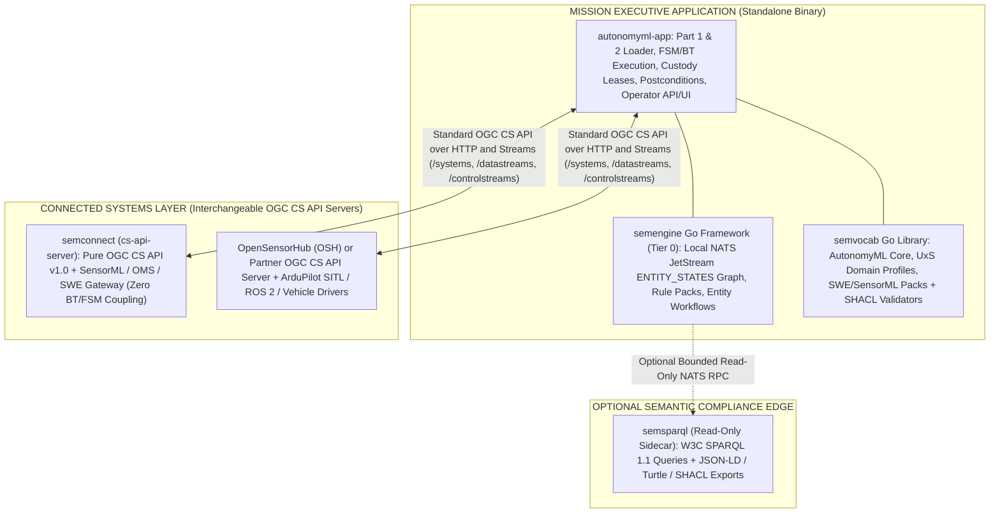
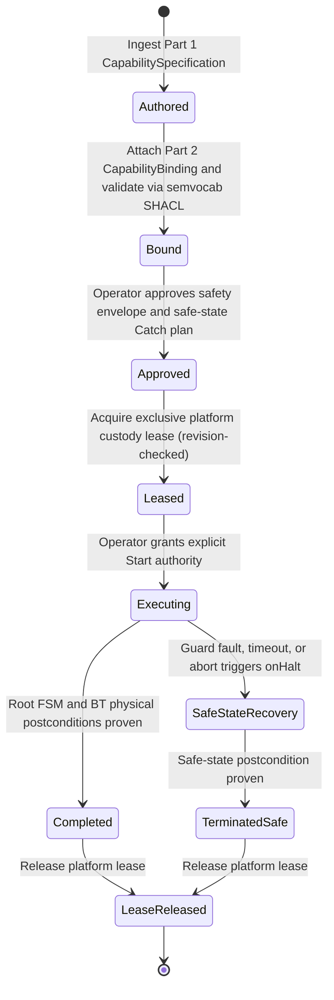
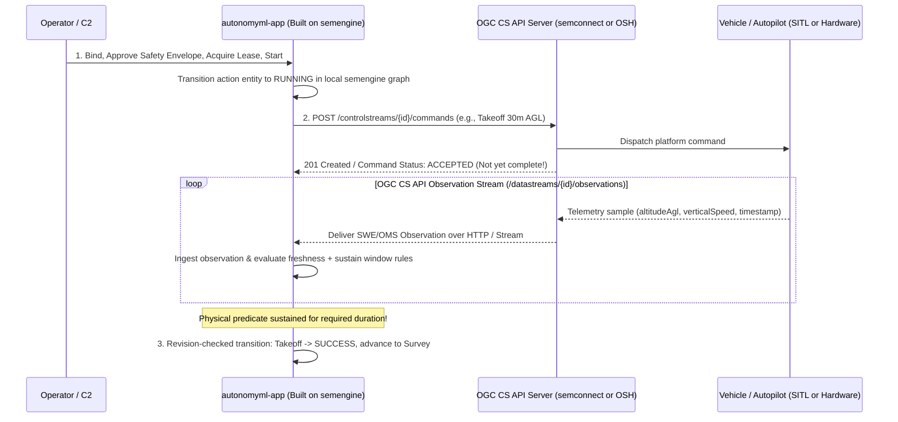
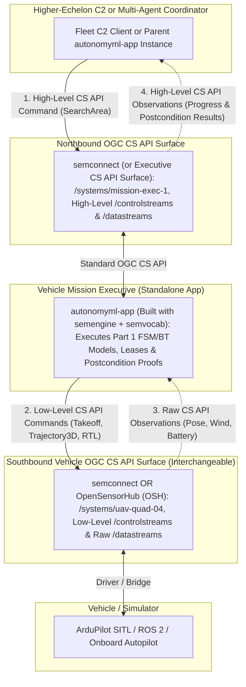
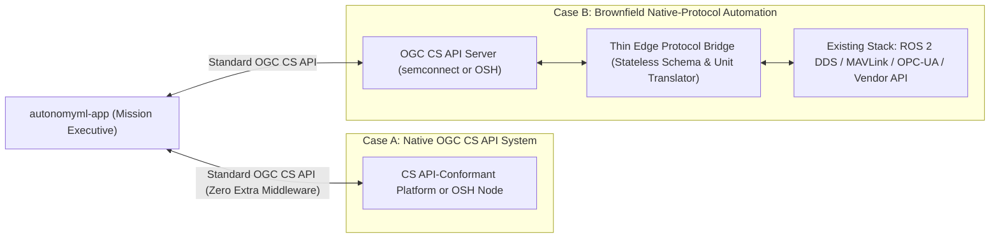

# Reference Runtime Architecture and Standards Boundaries: Separating AutonomyML from OGC Connected Systems, SensorML, and Existing Automation

## Executive Summary

**AutonomyML** is a vendor- and runtime-neutral open specification for describing reusable, observable autonomous capabilities (see [AutonomyML Overview.md](../../AutonomyML%20Overview.md)). When building a reference implementation and positioning the specification alongside existing OGC standards and brownfield robotics/automation stacks, three foundational architectural boundaries must be preserved:

1. **AutonomyML mission execution does not belong inside the OGC API - Connected Systems (CS API) server (`semconnect`).**
   * **`semconnect`** ([C360Studio/semconnect](https://github.com/C360Studio/semconnect)) remains a dedicated, standards-conformant **OGC API - Connected Systems v1.0 + SensorML** gateway/server.
   * **`autonomyml-app`** *(placeholder name)* is a **separate, standalone Mission Executive application** built using the **`semengine`** Go framework ([C360Studio/semengine](https://github.com/C360Studio/semengine)) and **`semvocab`** vocabulary/SHACL library ([C360Studio/semvocab](https://github.com/C360Studio/semvocab)).
   * At runtime, **`autonomyml-app` interacts with `semconnect` over standard OGC CS API HTTP and dynamic data streams**—making `semconnect`, [OpenSensorHub (OSH)](https://opensensorhub.org/), and any other conformant OGC CS API server completely interchangeable.
2. **AutonomyML imports and composes OGC SensorML 3.0 rather than extending it.**
   * AutonomyML directly reuses **SensorML 3.0 / SWE Common 3.0** for typed ports, units of measure, coordinate reference frames, and deterministic computational/dataflow processes—while keeping hierarchical FSM mode supervision, high-rate Behavior Tree ticks, closed-loop CS API physical postconditions, and custody/approval lifecycles outside SensorML.
3. **Existing automation systems are wrapped via Part 2 Bindings and thin edge protocol bridges—not replaced by custom orchestration middleware.**
   * AutonomyML requires **no** cross-system orchestration broker or shared runtime bus. Systems that already expose OGC CS API integrate with zero middleware via a **Part 2 (`CapabilityBinding`)** file; legacy/native-protocol stacks (ROS 2/DDS, MAVLink, OPC-UA/Modbus) use only a thin, mission-agnostic edge bridge to translate wire telemetry and commands into OGC CS API `/datastreams` and `/controlstreams`.

---

## 1. Why AutonomyML Execution Lives Outside `semconnect`

`semconnect` is designed with a crisp single responsibility: implementing an **[OGC API - Connected Systems v1.0](https://ogcapi.ogc.org/connectedsystems/)** server and its associated OGC encodings (**OMS**, **[SensorML 3.0](https://docs.ogc.org/is/23-000/23-000.html)**, **SWE Common**, **SOSA**, and GeoJSON/JSON-LD representations) verified against the official OGC executable test suite.

Keeping AutonomyML execution out of `semconnect` is critical for two reasons:

1. **`semconnect` Must Remain Usable for Non-Autonomous Connected Systems:**
   Weather stations, environmental sensor networks, fixed or pan-tilt-zoom cameras, and manual telemetry/command gateways need OGC CS API and SensorML—without Behavior Trees, Finite State Machines, or mission-executive governance anywhere in the server binary.
2. **OGC CS API Intentionally Has No Native Concept of Mission-Executive Semantics:**
   CS API standardizes feature resources (`/systems`, `/procedures`, `/deployments`, `/samplingFeatures`) and dynamic data channels (`/datastreams`, `/observations`, `/controlstreams`, `/commands`, `/systemEvents`). It deliberately does **not** define:
   * **Reactive Behavior Tree ticks or FSM mode transitions** (`RUNNING`, `SUCCESS`, `FAILURE` propagation at $N\text{ Hz}$, `onHalt` subtree preemption, or hierarchical mode statecharts).
   * **Single-pilot platform custody leases** preventing two executives or operators from issuing conflicting actuation commands to the same vehicle.
   * **Multi-stage human authority gates** (`Mission Authoring -> Platform Binding -> Safety Approval -> Start Authority`).
   * **Sustained physical postcondition proofs** (*Command Accepted $\neq$ Action Completed*) that monitor live observation streams before advancing a multi-step plan.

Baking those four concerns into `semconnect` would turn a clean OGC protocol server into a monolith and blur the boundary between **system interaction** and **behavioral supervision** in [AutonomyML Overview.md](../../AutonomyML%20Overview.md):

| Concern in [AutonomyML Overview](../../AutonomyML%20Overview.md) | Standard / Formalism | Architectural Owner |
| :--- | :--- | :--- |
| **Interaction with a particular system** (`/systems`, `/datastreams`, `/observations`, `/controlstreams`, `/commands`) | OGC CS API (Part 1 & Part 2) | **CS API Server Layer** (`semconnect`, OpenSensorHub, or third-party CS API gateway) |
| **Computational functions, typed ports, units & CRS metadata** | OGC SensorML 3.0 + SWE Common 3.0 | **Shared Semantic Interface** (validated via `semvocab`; described on systems in CS API and composed in `autonomyml-app`) |
| **Modes and transitions** | Finite State Machines (FSMs) | **Mission Executive App** (`autonomyml-app`, built with `semengine`) |
| **Reactive task composition** | Behavior Trees (BTs) | **Mission Executive App** (`autonomyml-app`, built with `semengine`) |
| **Execution lifecycles, custody leases & physical postconditions** | AutonomyML Part 1 & Part 2 | **Mission Executive App** (`autonomyml-app`, built with `semengine`) |

---

## 2. Why AutonomyML Is Not a SensorML Extension

As noted in [AutonomyML Overview.md](../../AutonomyML%20Overview.md), **[OGC SensorML 3.0 (`OGC 23-000`)](https://docs.ogc.org/is/23-000/23-000.html) is much more than static sensor metadata**: its process framework models computational algorithms (`SimpleProcess`), actuators (`PhysicalComponent` / `PhysicalSystem`), typed ports, configuration `modes`, and hierarchical dataflow chains (`AggregateProcess`). That naturally raises a key standards-architecture question: *why define AutonomyML as a distinct specification that imports SensorML rather than adding autonomous behavior extensions directly inside SensorML?*

### 2.1 Intentional Overlap: What AutonomyML Reuses Directly from SensorML 3.0 & SWE Common 3.0

AutonomyML deliberately **reuses** SensorML 3.0 and **[SWE Common 3.0 (`OGC 24-014`)](https://www.ogc.org/standards/swecommon/)** everywhere SensorML already solves the problem, avoiding duplicate type or process schemas:

| Capability / Concept | How SensorML 3.0 Models It | How AutonomyML Reuses It |
| :--- | :--- | :--- |
| **Typed ports, units & CRS frames** | `inputs`, `outputs`, and `parameters` typed with SWE Common (`Quantity`, `Vector`, `DataRecord`, `DataArray`, `Count`, UCUM `uom`, EPSG or local `referenceFrame`). | Reused directly for Part 1 capability `interface` ports and shared runtime `blackboard` variables. |
| **Computational algorithms** | `SimpleProcess` + `ProcessMethod` describing perception, estimation, coordinate transforms, or path-planning functions. | Invoked directly inside capabilities as SensorML process actions and mapped to concrete implementations via Part 2 `processBindings`. |
| **Deterministic dataflow pipelines** | `AggregateProcess` wiring child `components` together through port-to-port `connections`. | Used for pure signal-processing, sensor-fusion, or planning pipelines called by an autonomous capability. |
| **Outer system & procedure descriptions** | `PhysicalSystem` / `Procedure` exposed on an OGC CS API server. | A running Mission Executive (`autonomyml-app`) can publish its high-level capabilities northbound *as* SensorML-described procedures on `/systems/{id}` (see [Section 5](#5-hierarchical-autonomy-via-standard-ogc-cs-api)). |

> **Terminology Note — SensorML `modes` vs. AutonomyML FSM Modes:** SensorML includes a `modes` (`Mode` / `ModeChoice`) construct, but in SensorML a "mode" is a **static configuration preset** on a sensor or process (for example, switching a radar between high-gain and low-gain parameter values or changing a sampling rate)—not an executable statechart with guarded transitions, active-action preemption, and hierarchical fault recovery.

### 2.2 Four Architectural Reasons AutonomyML Does Not Belong Inside SensorML

Even with `SimpleProcess` and `AggregateProcess`, embedding AutonomyML inside SensorML breaks down across four boundaries:

1. **Dataflow Pipelines (`AggregateProcess`) $\neq$ Preemptive Behavioral Control Flow (FSM + BT):**
   * **SensorML's execution model is a dataflow graph:** Data arrives on `inputs`, moves across fixed `connections` through `components`, and exits on `outputs` (*how values transform through a pipeline*).
   * **AutonomyML's execution model is stateful, temporal, preemptive control flow:** It combines hierarchical statechart modes (mode invariants, conditional `choice` branches, and nested `try / catch` fault bubbling to approved safe states such as `ExecuteRTL` or `EmergencyLandImmediate`) with $10\text{–}50\text{ Hz}$ **Behavior Tree ticks** (`reactiveSequence`, `fallback`, `parallel`) that propagate `RUNNING`, `SUCCESS`, and `FAILURE` every cycle and immediately invoke `onHalt` preemption (`BRAKE_HOLD`, `LOITER_3D_HOLD`) to abort active subtrees mid-execution when a safety guard flips false. Encoding high-rate tick propagation and subtree preemption inside SensorML `connections` would contort a clean dataflow standard into an unnatural state/tick engine.
2. **Closed-Loop Physical Postconditions (*Command Accepted $\neq$ Action Completed*) Span Both SensorML and OGC CS API:**
   * SensorML is a foundational modeling standard usable even in offline metadata catalogs without OGC CS API, whereas live `/controlstreams`, `/commands`, `/datastreams`, and `/observations` belong to **OGC API - Connected Systems (`OGC 23-001` / `23-002`)**.
   * Every AutonomyML actuation step dispatches an asynchronous CS API command, remains `RUNNING` past `201 Created` / `ACCEPTED`, enforces observation freshness bounds, and transitions only when a deterministic predicate holds over incoming `DataStream` observations for a sustained duration. Putting AutonomyML inside SensorML would invert the OGC dependency stack by forcing SensorML to embed asynchronous CS API command-and-observation correlation semantics.
3. **Protecting SensorML's Non-Autonomy Ecosystem from Specification Bloat:**
   * Mirroring why Mission Executive logic stays out of `semconnect` in [Section 1](#1-why-autonomyml-execution-lives-outside-semconnect), the vast majority of SensorML deployments—weather stations, satellite radiometric calibration chains, stream gauges, hydrographic sensors, laboratory instruments, and fixed cameras—have **no** Behavior Trees, statecharts, or UxS safe-state recovery plans. Adding expression evaluators, Behavior Tree tick semantics, and fault-bubbling rules into SensorML would burden every earth-observation and IoT parser and conformance test suite with mission-executive complexity they never use.
4. **Operational Governance, Custody Leases & Part 1 / Part 2 Lifecycles:**
   * SensorML describes *what a sensor, actuator, or process is and how its ports and calibration chain are wired*.
   * AutonomyML governs **operational authority and resource coordination** ([AutonomyML Overview.md](../../AutonomyML%20Overview.md)): separating portable **Part 1 (`CapabilitySpecification`)** models from per-vehicle **Part 2 (`CapabilityBinding`)** mappings, enforcing multi-stage human safety approvals (`Author -> Bind -> Approve -> Start`), and holding exclusive single-pilot **custody leases** so two executives cannot issue conflicting commands. Those operational governance concerns lie outside a sensor and process modeling standard.

### 2.3 Layered Composition Across the OGC Standards Stack

Framing the relationship as **layered composition rather than extension** gives each standard a crisp, non-overlapping role:

| Layer | Standard | Primary Role in the Stack |
| :--- | :--- | :--- |
| **Data Types & Units** | **OGC SWE Common 3.0** | The **nouns** — typed quantities, vectors, records, UCUM units of measure, and coordinate reference frames. |
| **Hardware & Dataflow Functions** | **OGC SensorML 3.0** | The **components & pipelines** — physical sensor/actuator descriptions, calibration chains, and computational processes (`SimpleProcess`, `AggregateProcess`). |
| **System I/O & Telemetry Transport** | **OGC API - Connected Systems** | The **nervous system** — live `/systems`, `/datastreams` observations, and `/controlstreams` commands/status. |
| **Behavioral Supervision & Governance** | **AutonomyML (Part 1 & Part 2)** | The **executive** — portable FSM modes, reactive Behavior Trees, sustained physical postconditions, custody leases, and safety-approval lifecycles that **import** SWE Common types, **invoke** SensorML processes, and **drive** OGC CS API streams. |

---

## 3. Framework vs. Vocabulary Library vs. Independent Applications

In the C360 reference ecosystem, `semengine` is **not** a central shared daemon that couples applications together in memory. Rather, **`semengine` is a Go application framework** and **`semvocab` is a Go vocabulary/SHACL library** that independent applications compile into their own binaries—each owning its own operational state, entity authority, and public interface:

### 3.1 `semengine` — The Go Application Framework
* **Framework, Not a Monolith:** [`semengine`](https://github.com/C360Studio/semengine) is a Go framework for building applications around a live semantic knowledge graph backed by NATS JetStream, paired with deterministic rules and entity workflows. It has no domain semantics of its own; each consumer application wires its own `main` binary, registering only the `semengine` components (`graph-ingest`, `graph-index`, `graph-query`, `rule-processor`, `objectstore`, etc.) and payload types it uses.
* **Tier-0 Edge & Offline Execution:** `semengine`'s Tier-0 baseline requires **no external LLM or embedding provider**, making it purpose-built for deterministic, offline-first, edge-capable mission execution.
* **Authority, Revisions, Rules & Workflows:**
  * Entities use structured six-part dot-separated IDs (`org.platform.system.domain.type.instance`) scoped to each deployment's `org.platform` authority, with flat dotted predicates stored in NATS KV (`ENTITY_STATES`).
  * State reconciliations support optimistic concurrency via explicit **revision** checks (`revision-conflict` rejects stale concurrent writes).
  * JSON **rule packs** (validated at startup) watch entity state transitions and trigger deterministic actions, while **entity workflows** persist lifecycle phases directly on entities across restarts.

### 3.2 `semvocab` — Vocabulary Packs & SHACL Contract Library
* **Practical Runtime Terms + Standard Ontologies:** [`semvocab`](https://github.com/C360Studio/semvocab) is a Go library that populates `semengine/vocabulary` without forcing core services to manipulate raw RDF blank-node chains on the hot path.
* **Packs & SHACL Compilation:** Provides ontology IRI catalogs, modular **vocabulary packs** (registering entity types, flat dotted predicates, and standard ontology IRI projections), and a **SHACL compiler** (`shacl.Compile`) that turns W3C SHACL shapes and mappings into write contracts and complete-state entity validators.
* **For `autonomyml-app`:** Supplies the vocabulary packs and SHACL validators for SWE Common / SensorML port metadata, **AutonomyML Core** (FSM states, BT nodes, custody leases, authority phases, postconditions), and **Layer 2 UxS Domain Profiles** (Aerial, Ground Rover, Maritime).

### 3.3 `semconnect` — Standalone OGC CS API Server
* **Pure Connected Systems Gateway:** [`semconnect`](https://github.com/C360Studio/semconnect) (`cs-api-server`) is an independent consumer application owning OGC CS API Part 1 & Part 2 HTTP/stream surfaces, OMS observations, SensorML system/process descriptions, SWE Common schemas, and OGC conformance testing.
* **Decoupled from `autonomyml-app`:** `semconnect` runs its own deployment authority and storage lifecycle. It never imports AutonomyML rule packs, Behavior Tree evaluators, or mission custody logic.

### 3.4 `autonomyml-app` — Standalone AutonomyML Mission Executive
* **Built on `semengine` + `semvocab`:** `autonomyml-app` is an independent consumer application whose `main` composes `semengine`'s Tier-0 graph, rule processor, and entity workflow primitives with AutonomyML `semvocab` packs.
* **Speaks Standard OGC CS API Externally:** Connects to target platforms through standard OGC CS API endpoints—meaning `autonomyml-app` treats `semconnect`, OpenSensorHub, or any conformant CS API vehicle gateway identically.

### 3.5 `semsparql` *(Optional)* — Read-Only Semantic Audit Sidecar
* When a program or assurance workflow requires external W3C SPARQL 1.1 queries (`SELECT`, `ASK`, `CONSTRUCT`, `DESCRIBE`) or unfolded JSON-LD / Turtle exports for external SHACL compliance gates, [`semsparql`](https://github.com/C360Studio/semsparql) attaches beside a `semengine` deployment as a bounded, **read-only** translator—never mutating live mission state.

---

## 4. What `autonomyml-app` Owns as the Mission Executive

Building `autonomyml-app` on `semengine` and `semvocab` maps every Mission Executive responsibility cleanly onto deterministic framework primitives while keeping external vehicle interactions 100% standard OGC CS API:

### 4.1 Part 1 & Part 2 Ingestion and Profile Validation
* Parses portable **AutonomyML Part 1 (`CapabilitySpecification`)** models and **Part 2 (`CapabilityBinding`)** documents.
* Uses `semvocab`-compiled SHACL validators and vocabulary packs to verify SWE Common units of measure, coordinate reference frames (e.g., `EPSG:4326` vs. `EPSG:4979` + `AGL`), required domain-profile safe-state `Catch` handlers, and bound CS API `/datastreams` and `/controlstreams` schemas before execution is ever armed.

### 4.2 FSM Mode Supervision & Reactive Behavior Tree Execution
* Tracks macro-modes (e.g., `Takeoff`, `Survey`, `ExecuteRTL`, `SafeHoldFallback`) and reactive Behavior Tree node states (`RUNNING`, `SUCCESS`, `FAILURE`) as typed entities in `autonomyml-app`'s local `semengine` graph.
* Compiles mode transitions, guard conditions, and fault escalations into startup-validated `semengine` rule packs and revision-checked entity workflows—invoking explicit `onHalt` preemption commands on active CS API `ControlStreams` whenever a reactive guard fails or an operator aborts.

### 4.3 Custody Leases & Human Authority Gates (`Author -> Bind -> Approve -> Start`)
Because OGC CS API intentionally allows any authorized client to `POST` commands to a `/controlstream`, safety-critical UxS governance lives in `autonomyml-app`'s entity workflows:

* **Substantiates Part 1 of AutonomyML:** Directly implements *Execution Lifecycles* and *Resource Coordination* from [AutonomyML Overview.md](../../AutonomyML%20Overview.md) without adding proprietary HTTP verbs to OGC CS API.
* **Prevents Split-Brain Actuation:** Optimistic `revision` checks on entity state inside `autonomyml-app` ensure two concurrent transitions or competing mission runs cannot simultaneously claim custody of the same bound platform.

### 4.4 Sustained Physical Postcondition Proofs (*Command Accepted $\neq$ Action Completed*)

---

## 5. Hierarchical Autonomy via Standard OGC CS API

Keeping `autonomyml-app` decoupled from `semconnect` and communicating strictly over **OGC CS API** unlocks **hierarchical (recursive) autonomy** directly aligned with the **AutonomyML Goal**:

> *"AutonomyML ensures that different independent autonomous UxS system implementations publish their autonomy capabilities openly via a standard that enables the description of equivalent observable behavior, without relying on undocumented conventions inside its components."*
> — [AutonomyML Overview.md](../../AutonomyML%20Overview.md)

Because `autonomyml-app` defines its own high-level capabilities (such as `SearchArea`, `InspectTarget`, or `TakeoffSurveyAndRTL`) using **SensorML-typed inputs, parameters, and outputs**, the Mission Executive itself can be published and tasked northbound as a standard OGC Connected System:

1. **Southbound Portability (`semconnect` $\leftrightarrow$ OpenSensorHub):**
   `autonomyml-app` consumes raw vehicle `/datastreams` and tasks low-level `/controlstreams` over standard OGC CS API. Switching a testbed from an OpenSensorHub + ArduPilot SITL simulator to a `semconnect`-fronted platform requires **only a Part 2 `CapabilityBinding` URL/stream change**—zero code changes in `autonomyml-app` and zero changes to the Part 1 `CapabilitySpecification`.
2. **Northbound Composability (Multi-Echelon C2 & Swarms):**
   Higher-echelon C2 tools—or a parent **Layer 3 Multi-Agent Coordinator**—do not need a proprietary RPC protocol to talk to `autonomyml-app`. They discover the executive's published SensorML capabilities, issue high-level commands to `/controlstreams`, and monitor mission progress on `/datastreams` using standard OGC CS API.

---

## 6. Integrating Existing Automation Systems: Do We Need Middleware?

Real-world UxS fleets, robotics labs, and industrial deployments already run mature automation stacks—such as **ROS 2 / Nav2**, **ArduPilot / PX4 (MAVLink)**, marine autopilots, **PLC / OPC-UA / SCADA** controllers, and enterprise C2/orchestration tools. AutonomyML handles these existing systems by **wrapping and composing them across OGC CS API + SensorML** rather than replacing them.

### 6.1 Wrapping vs. Replacing Brownfield Automation Stacks

1. **Decouple Portable Behavior (Part 1) from Existing System Wiring (Part 2):**
   * **Part 1 (`CapabilitySpecification`)** expresses portable behavior against symbolic stream and process URIs—containing zero vendor wire protocols or topic names.
   * **Part 2 (`CapabilityBinding`)** maps those symbolic URIs (including preemption `onHalt` actions such as `BRAKE_HOLD` or `LOITER_3D_HOLD`) to a concrete platform's `/controlstreams`, `/datastreams`, and SensorML processes. A ROS 2 Nav2 ground rover and an ArduRover/MAVLink UGV keep their native controllers intact and satisfy the exact same Part 1 capability by swapping only the Part 2 binding file.
2. **Black-Box Observable Equivalence (*Command Accepted $\neq$ Action Completed*):**
   * Per the Goal in [AutonomyML Overview.md](../../AutonomyML%20Overview.md), AutonomyML never requires access to undocumented internal conventions inside an existing autopilot, ROS node, or PLC controller.
   * An existing system that already runs its own internal autonomy loop (for example, an onboard Nav2 Behavior Tree or an industrial sequence) can either **publish** an AutonomyML capability describing its observable ports and safe-state guarantees, or be invoked as a black-box action whose physical completion is verified externally from `/datastreams` observations.
3. **Bidirectional Brownfield Integration (Southbound & Northbound):**
   * **Southbound:** `autonomyml-app` tasks existing vehicle or equipment automation behind OGC CS API.
   * **Northbound:** Existing C2 consoles, fleet managers, or enterprise workflow orchestrators can discover and task `autonomyml-app` (`/systems/mission-exec-1`) over standard OGC CS API HTTP/streams without adopting an AutonomyML-specific SDK.

### 6.2 Orchestration Middleware vs. Thin Edge Protocol Bridges

Whether "middleware" is required depends strictly on distinguishing **cross-system orchestration middleware** from **edge protocol translation**:

| Middleware Category | Needed? | Architectural Stance |
| :--- | :--- | :--- |
| **Central AutonomyML orchestration / message-broker middleware** | **No** | Explicitly avoided. `semengine` (and its local NATS JetStream `ENTITY_STATES` graph) is compiled *inside* `autonomyml-app` as an internal Go framework—never exposed as a shared bus that external automation systems must join. Across process and network boundaries, systems speak **standard OGC CS API**. If an existing platform already exposes OGC CS API, **zero middleware is needed**. |
| **Thin edge protocol gateway / driver bridge** *(for MAVLink, ROS 2 DDS, OPC-UA/Modbus, vendor APIs)* | **Yes (thin & mission-agnostic)** | Most existing automation stacks do not speak OGC CS API natively. Rather than embedding hardware or wire drivers inside `autonomyml-app`, a thin **CS API Gateway + Protocol Bridge** translates native telemetry and commands into `/datastreams` and `/controlstreams`: • **OpenSensorHub (OSH):** Turnkey OGC CS API server with built-in Java driver modules (MAVLink/ArduPilot, ROS, sensors). • **`semconnect` + lightweight protocol bridges:** Pairs `semconnect` with small edge adapters (`MAVLink <-> CS API`, `ROS 2 <-> CS API`, `OPC-UA <-> CS API`) that **only** translate wire schemas, timestamps, and SWE Common units—leaving all FSM modes, BT ticks, custody leases, and postcondition proofs in `autonomyml-app`. |

### 6.3 Open Brownfield Integration Questions

To formalize brownfield integration in future specification and reference-stack work, two practical boundaries remain to be detailed:

1. **Connector Pattern for `semconnect`:** Defining the standard ingest and command-dispatch contract for external protocol bridges (`ROS 2`, `MAVLink`, `OPC-UA`) paired with `semconnect`, contrasted with OpenSensorHub's in-process Java driver model.
2. **"Wrap vs. Orchestrate" Domain-Profile Guidance:** Establishing clear guidance on when to wrap an existing system's entire onboard workflow (e.g., an existing Nav2 Behavior Tree or PLC routine) as one coarse CS API capability versus supervising its lower-level primitives from `autonomyml-app`.

---

## 7. Summary of Repository, Gateway, and Application Boundaries

| Repository / Component | Kind | Primary Responsibility | Explicit Non-Goals (Kept Out of Scope) |
| :--- | :--- | :--- | :--- |
| **`autonomyml`** *(this repo)* | **Open Specification** | Vendor-neutral AutonomyML Part 1 (Specifications), Part 2 (Bindings), domain profile definitions, schemas, and architectural documentation. | Tying the open language standard to any single vendor's internal wire bus or extending SensorML with executive semantics. |
| **[`semvocab`](https://github.com/C360Studio/semvocab)** | **Go Library** | Ontology IRI catalogs, modular vocabulary packs (OGC terms, AutonomyML Core, UxS Domain Profiles), and SHACL-to-contract/validator compilation for `semengine`. | Running network servers, storing live runtime state, or executing mission loops. |
| **[`semengine`](https://github.com/C360Studio/semengine)** | **Go Framework** | Tier-0 offline/edge-capable NATS JetStream knowledge graph (`ENTITY_STATES`), optimistic revision-checked writes, entity workflows, and JSON rule-pack engine. | Acting as cross-system middleware, or embedding OGC CS API routes, SensorML parsers, or AutonomyML BT/FSM semantics. |
| **[`semconnect`](https://github.com/C360Studio/semconnect)** | **Standalone App** | Pure OGC API - Connected Systems v1.0 + SensorML / OMS / SWE server (`cs-api-server`) verified against OGC conformance suites; interchangeable with OpenSensorHub. | Behavior Tree ticking, FSM mission supervision, custody leases, approval gates, or postcondition loops. |
| **Edge Protocol Bridges / OSH Drivers** | **Thin Adapters** | Stateless wire-protocol translation (`MAVLink`, `ROS 2 DDS`, `OPC-UA/Modbus`, vendor APIs $\leftrightarrow$ OGC CS API `/datastreams` & `/controlstreams` in SWE Common / OMS). | Autonomous mode logic, safety-envelope policy, custody locks, or multi-step mission orchestration. |
| **`autonomyml-app`** *(placeholder)* | **Standalone App** | Reference AutonomyML Mission Executive built using `semengine` + `semvocab`; executes Part 1/2 models, leases, authority gates, and postconditions against any OGC CS API server. | Re-implementing an OGC CS API server monolith or embedding raw autopilot/PLC wire drivers directly in plans. |
| **[`semsparql`](https://github.com/C360Studio/semsparql)** *(optional)* | **Read-Only Sidecar** | Edge translator for W3C SPARQL 1.1 queries and unfolded JSON-LD / Turtle exports for external SHACL compliance and audit workflows. | Mutating live operational state or sitting in the real-time vehicle control loop. |

---

## 8. References

1. **AutonomyML Overview** — [AutonomyML Overview.md](../../AutonomyML%20Overview.md)
2. **OGC API - Connected Systems — Part 1: Feature Resources (OGC 23-001) & Part 2: Dynamic Data (OGC 23-002)** — [https://ogcapi.ogc.org/connectedsystems/](https://ogcapi.ogc.org/connectedsystems/)
3. **OGC Sensor Model Language (SensorML) 3.0 Standard (OGC 23-000)** — [https://docs.ogc.org/is/23-000/23-000.html](https://docs.ogc.org/is/23-000/23-000.html)
4. **OGC SWE Common Data Model 3.0 Standard (OGC 24-014)** — [https://www.ogc.org/standards/swecommon/](https://www.ogc.org/standards/swecommon/)
5. **OpenSensorHub (OSH)** — [https://opensensorhub.org/](https://opensensorhub.org/)
6. **C360Studio SemEngine (Go Knowledge-Graph & Durable Execution Framework)** — [https://github.com/C360Studio/semengine](https://github.com/C360Studio/semengine)
7. **C360Studio SemVocab (Ontology Packs & SHACL Compiler)** — [https://github.com/C360Studio/semvocab](https://github.com/C360Studio/semvocab)
8. **C360Studio SemConnect (OGC API - Connected Systems Gateway)** — [https://github.com/C360Studio/semconnect](https://github.com/C360Studio/semconnect)
9. **C360Studio SemSparql (Read-Only W3C SPARQL 1.1 & RDF/JSON-LD Sidecar)** — [https://github.com/C360Studio/semsparql](https://github.com/C360Studio/semsparql)
