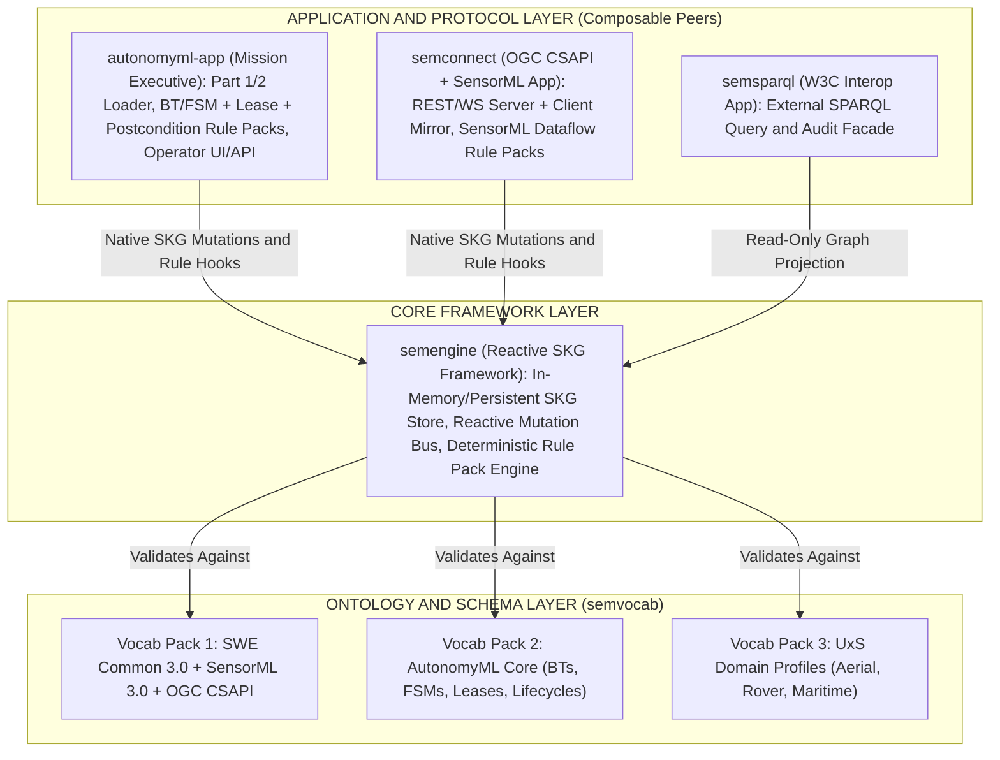
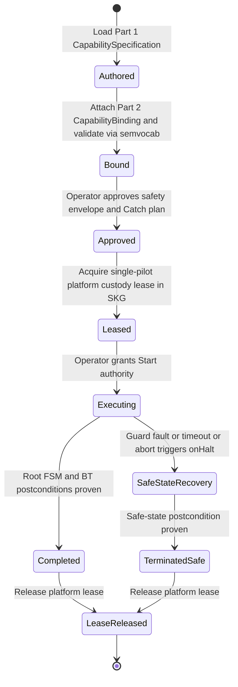
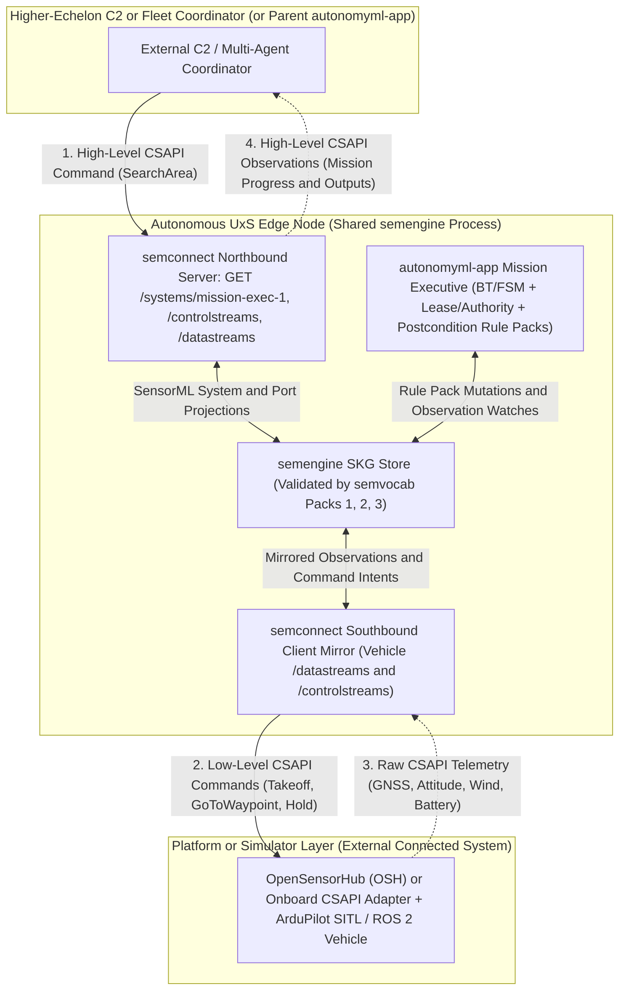
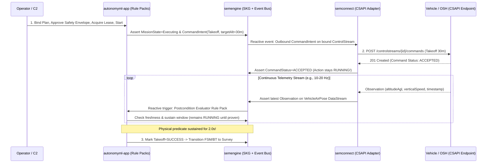

# Reference Runtime Architecture and Module Boundaries: Separating the AutonomyML Mission Executive from OGC Connected Systems

## Executive Summary

While **AutonomyML** itself is a vendor- and runtime-neutral open specification (see [AutonomyML Overview.md](../../AutonomyML%20Overview.md)), validating the specification requires a clean **Reference Implementation Stack** capable of executing **Part 1 (Specifications)** and **Part 2 (Bindings)** against real and simulated vehicles (such as OpenSensorHub paired with ArduPilot SITL or ROS 2).

A critical architectural question arises immediately when designing that reference stack: **Should AutonomyML execution semantics live inside the OGC API - Connected Systems (`semconnect`) server/adapter, or in a separate Mission Executive application (`autonomyml-app`)?**

Baking AutonomyML into `semconnect` muddles both layers. Instead, **the Mission Executive Layer (`autonomyml-app`) and the Connected Systems Protocol Layer (`semconnect`) must remain separate, peer applications** composed over a domain-agnostic reactive graph framework (`semengine`) and a shared ontology registry (`semvocab`).

> **Naming Note:** Throughout this document, `autonomyml-app` is used as a generic placeholder name for the reference AutonomyML Mission Executive application (alongside `semvocab`, `semengine`, `semconnect`, and `semsparql`).

---

## 1. Why Putting AutonomyML Inside `semconnect` Muddles the Architecture

At its core, `semconnect` is an **[OGC API - Connected Systems (CSAPI)](https://ogcapi.ogc.org/connectedsystems/) + [OGC SensorML 3.0](https://docs.ogc.org/is/23-000/23-000.html)** server and client adapter:

* **General-Purpose Connected Systems Reuse:** `semconnect` should be usable out of the box for *any* OGC Connected Systems deployment—weather stations, environmental buoy networks, fixed or gimbaled cameras, industrial IoT sensors, or manual telemetry and tasking setups—where **no** Behavior Trees, Finite State Machines, or autonomous mission executives exist at all.
* **Concepts Intentionally Outside OGC CSAPI:** The OGC CSAPI standard models system metadata (`/systems`, `/deployments`), observation streams (`/datastreams`, `/observations`), and command channels (`/controlstreams`, `/commands`, `/commands/{id}/status`). CSAPI intentionally has **no native concept of**:
  1. **Reactive Behavior Tree ticks or FSM mode transitions** (`RUNNING`, `SUCCESS`, `FAILURE` propagation at $N\text{ Hz}$, subtree halting/preemption, or hierarchical statecharts).
  2. **Single-pilot platform leases and custody locks** preventing conflicting executives or operators from actuating the same vehicle simultaneously.
  3. **Human Authority Lifecycle Gates** separating `Mission Authoring -> Platform Binding -> Safety Envelope Approval -> Start Authority`.
  4. **Multi-step Physical Postcondition Evaluation** verifying sustained physical achievement over incoming telemetry (*Command Accepted $\neq$ Action Completed*) before advancing a mission plan.

If those four concerns are crammed into `semconnect`, `semconnect` ceases to be a lightweight, standards-pure OGC adapter and becomes a tightly coupled monolith. Worse, conflating command transport with behavioral supervision violates the foundational separation between the **Mission Executive Layer** and the **Connected Systems Layer** reflected in [AutonomyML Overview.md](../../AutonomyML%20Overview.md):

| Architectural Concern | Mechanism in [AutonomyML Overview](../../AutonomyML%20Overview.md) | Reference Module Owner | Why It Lives Here |
| :--- | :--- | :--- | :--- |
| **Typed units, CRS frames, port schemas, and domain terms** | SensorML / SWE Common + Layer 1–2 Vocabularies | `semvocab` | Pure declarative schemas & ontologies shared offline and at runtime with zero execution state. |
| **Reactive state storage & deterministic rule evaluation** | Execution Environment Foundation | `semengine` | Domain-agnostic Semantic Knowledge Graph (SKG), mutation event bus, and Rule Pack runtime. |
| **System interaction, streams, and SensorML dataflow** | OGC CSAPI + SensorML Processes | `semconnect` | Pure OGC CSAPI REST/WS server & client adapter plus SensorML port-wiring / `SimpleProcess` execution. |
| **Modes, reactive behaviors, leases, safety gates & postconditions** | FSMs + BTs + Part 1 Lifecycles & Resource Coordination + Part 2 Bindings | `autonomyml-app` | AutonomyML Mission Executive compiling plans, leases, authority gates, and physical postconditions into `semengine` Rule Packs. |
| **External semantic graph queries & assurance audits** | W3C SPARQL 1.1 Interoperability | `semsparql` *(optional)* | Read/query facade over `semengine` without coupling W3C query protocols into CSAPI or the executive. |

---

## 2. The Clean Split: Ontologies vs. Core Framework vs. Composable Apps

Because `semengine` provides a domain-agnostic SKG store, reactive event dispatcher, and deterministic Rule Pack engine—and `semvocab` provides the modular ontology/schema packs—`autonomyml-app`, `semconnect`, and `semsparql` cleanly plug into `semengine` as **peer, composable modules**:

Splitting the stack along these seams gives every layer a crisp **Single Responsibility**:

### 2.1 `semvocab` — The Ontologies & Schema Registry
* **Zero Runtime Coupling:** Contains declarative ontologies, RDF/SHACL or JSON Schema definitions, units of measure, and profile constraints—no network servers, state stores, or imperative rule loops.
* **Modular Vocabulary Packs:**
  * **Vocab Pack 1 (OGC Sensor Web Foundation):** SWE Common 3.0 (`Quantity`, `Vector`, `DataRecord`, UCUM units, EPSG/local CRS reference frames), SensorML 3.0 (`PhysicalSystem`, `SimpleProcess`, `AggregateProcess`, typed `inputs`/`outputs`/`parameters`), and OGC CSAPI resource descriptors.
  * **Vocab Pack 2 (AutonomyML Core — Layer 1):** FSM state/event primitives, Behavior Tree node types and tick statuses (`RUNNING`, `SUCCESS`, `FAILURE`), physical postcondition contracts, single-pilot custody leases, and human authority gate states.
  * **Vocab Pack 3 (UxS Domain Profiles — Layer 2):** Platform-class profiles (Aerial UxS, Ground Rover, Maritime/Subsurface) defining required coordinate frames, standard capability interfaces, operational envelopes, and approved safe-state recovery hierarchies.
* **Selective Loading:** A standalone `semconnect` weather-station deployment only needs **Vocab Pack 1**; adding `autonomyml-app` loads **Vocab Packs 2 and 3** into the same registry without modifying Vocab Pack 1.

### 2.2 `semengine` — The Core Reactive Framework
* **Strict Domain Ignorance:** `semengine` knows **nothing** about OGC, SensorML, CSAPI, HTTP/WebSockets, Behavior Trees, or AutonomyML.
* **Three Core Primitives:**
  1. Stores typed SKG nodes and edges validated against loaded `semvocab` schemas (in-memory for low-latency onboard/edge execution, with optional persistence/journaling).
  2. Emits deterministic reactive events whenever graph triples/properties mutate.
  3. Schedules and executes registered **Rule Packs** deterministically against graph state transitions.

### 2.3 `semconnect` — The OGC CSAPI + SensorML App/Plugin
* **Single Responsibility:** OGC Connected Systems (Part 1 & Part 2) and SensorML 3.0 interoperability.
* **SensorML Ingestion & Dataflow:** Parses SensorML 3.0 descriptions, asserts `System` instances and their typed `Input`, `Output`, and `Parameter` ports into `semengine`'s SKG, and registers the **SensorML Dataflow Rule Pack** (wiring connected ports and invoking `SimpleProcess` computational methods).
* **Dual Network Role (Server + Client Mirror):**
  * **CSAPI Server:** Exposes SKG systems, deployments, and ports to external consumers as standard OGC CSAPI endpoints (`/systems`, `/datastreams`, `/controlstreams`, `/observations`, `/commands`).
  * **CSAPI Client Adapter:** Connects outbound to external OGC CSAPI instances—such as **OpenSensorHub (OSH)** fronting an ArduPilot SITL autopilot, MAVLink bridge, or ROS 2 node—and mirrors remote `/datastreams` observations and `/controlstreams` command/status resources into the local `semengine` SKG.

### 2.4 `autonomyml-app` — The AutonomyML Mission Executive App
* **Single Responsibility:** Reference Mission Executive implementing **AutonomyML Part 1 (Specifications)** and **Part 2 (Bindings)**.
* **Plan & Binding Ingestion:** Loads portable AutonomyML capability specifications (hybrid FSMs + BTs) and concrete platform bindings, validating port types, units, CRS frames, and required domain-profile safe-state plans against `semvocab`.
* **Registers Three AutonomyML Rule Packs into `semengine`:**
  1. **BT / FSM Execution Rule Pack:** Ticks active Behavior Trees (`RUNNING`, `SUCCESS`, `FAILURE`), invokes `onHalt` preemption on interrupted branches, and evaluates guarded FSM mode and fault (`Catch`) transitions over SKG state.
  2. **Lease & Safety Gate Rule Pack:** Enforces single-pilot platform custody locks (Part 1 *Resource Coordination*) and deterministic human authority gates (`Author -> Bind -> Approve -> Start`).
  3. **Postcondition Evaluator Rule Pack:** Watches live telemetry observations in the SKG (enforcing freshness bounds and sustained predicate durations) to prove physical completion before marking an action `SUCCESS`.
* **Operator Control Surface:** Exposes the operator UI and control API used to load a mission specification, bind it to a target vehicle, verify and approve the safety envelope, acquire custody, and issue `Start` or emergency `Abort`/`Hold`.

---

## 3. Governance in `autonomyml-app`: Authority Lifecycle and Custody Leases

One of the sharpest illustrations of why `autonomyml-app` belongs outside `semconnect` is **operational governance**. In OGC CSAPI, an authorized client can `POST` an individual command to `/controlstreams/{id}/commands` at any time; CSAPI is deliberately agnostic to whether that command came from a joystick UI, a test script, or an autonomous planner.

Safety-critical UxS autonomy, by contrast, requires explicit lifecycle gates and exclusive actuation custody before a Behavior Tree or State Machine is allowed to emit physical vehicle commands:

Keeping this lifecycle inside `autonomyml-app`'s **Lease & Safety Gate Rule Pack** achieves two goals simultaneously:
1. **Substantiates Part 1 of AutonomyML:** Directly implements the *Execution Lifecycles* and *Resource Coordination* pillars in [AutonomyML Overview.md](../../AutonomyML%20Overview.md) without inventing non-standard extensions to OGC CSAPI HTTP verbs.
2. **Protects Shared Vehicles in Multi-App Topologies:** Because the custody lease lives as first-class state in `semengine`'s SKG, `autonomyml-app` refuses to enter `Executing` if another executive instance or manual safety pilot holds the lease—and immediately transitions to `SafeStateRecovery` if its lease is revoked or preempted.

---

## 4. The Architectural Superpower: Hierarchical (Recursive) Autonomy

Keeping `autonomyml-app` separate from `semconnect` over a shared `semengine` SKG unlocks a major architectural capability that directly fulfills the **AutonomyML Goal**:

> *"AutonomyML ensures that different independent autonomous UxS system implementations publish their autonomy capabilities openly via a standard that enables the description of equivalent observable behavior, without relying on undocumented conventions inside its components."*
> — [AutonomyML Overview.md](../../AutonomyML%20Overview.md)

Because `autonomyml-app` writes its Mission Executive state and high-level capabilities (such as `SearchArea`, `InspectTarget`, or `TakeoffSurveyAndRTL`) into `semengine`'s SKG using **SensorML-typed inputs, parameters, and outputs**, `semconnect` can automatically expose `autonomyml-app` **itself** as a higher-level OGC Connected System!

### Northbound vs. Southbound Symmetry

1. **Southbound (Down to the Vehicle / OpenSensorHub):**
   `autonomyml-app` uses `semconnect` (specifically its outbound CSAPI client adapter) to dispatch low-level `Takeoff`, `Navigate2D`, or `ReturnToLaunch` commands to an OpenSensorHub / ArduPilot SITL or ROS 2 driver and to ingest raw GNSS, attitude, velocity, and battery `/observations` into the SKG.
2. **Northbound (Up to C2 or a Multi-Vehicle Coordinator):**
   Because `autonomyml-app` registers its own executive capability interfaces in the exact same `semengine` SKG, an external Command-and-Control (C2) client—or a higher-echelon **Layer 3 Multi-Agent Coordinator**—can query `semconnect` (`GET /systems/mission-exec-1`), inspect the Mission Executive's typed SensorML capabilities, submit a high-level mission command to its `/controlstreams`, and subscribe to mission progress and verified postcondition outcomes on its `/datastreams`.

No custom C2 wire protocol is needed: **every echelon of autonomy speaks standard OGC CSAPI + SensorML externally while executing deterministic AutonomyML models internally.**

---

## 5. End-to-End Reactive Execution Trace Across Module Boundaries

To see how clean the runtime handoffs remain in practice, trace how a single action node (for example, `Takeoff` or `DriveToWaypoint`) executes without `semconnect` ever knowing what a Behavior Tree is, and without `autonomyml-app` embedding HTTP/WebSocket transport logic:

Notice two architectural invariants in this trace:
* **Transport vs. Proof Separation:** `semconnect` faithfully reports `CommandStatus=ACCEPTED` into the SKG, while `autonomyml-app`'s Postcondition Evaluator Rule Pack enforces *Command Accepted $\neq$ Action Completed* by holding the capability state in `RUNNING` until sustained telemetry observations satisfy the physical postcondition.
* **Deployment Flexibility (Co-Located or Distributed):**
  * **In-Process Edge Binary:** `autonomyml-app` and `semconnect` link into a single Go binary sharing an in-memory `semengine` SKG—delivering sub-millisecond reactive ticks and zero-copy northbound CSAPI exposure.
  * **Split Over-the-Wire Deployment:** Because `Part 2 (Bindings)` targets standard OGC CSAPI URIs, `autonomyml-app` paired with a local `semconnect` client mirror can equally drive a remote `semconnect` or OpenSensorHub instance across a network link with zero changes to the Part 1 or Part 2 AutonomyML documents.

---

## 6. Summary: Repository and Module Boundaries

Keeping the reference ecosystem split along these boundaries prevents architectural drift and ensures every package has an unambiguous dependency graph:

| Module / Repo | Role | Allowed Dependencies | Explicitly Excluded |
| :--- | :--- | :--- | :--- |
| **`semvocab`** | Pure ontologies & schemas: **Pack 1** (SWE Common, SensorML, CSAPI), **Pack 2** (AutonomyML Core), **Pack 3** (UxS Domain Profiles). | Standard schema / RDF / JSON libraries only. | Runtime state stores, rule engines, HTTP servers, vehicle drivers. |
| **`semengine`** | Pure Semantic Knowledge Graph (SKG) store, reactive mutation bus, and deterministic Rule Pack engine. | `semvocab` (for schema/vocabulary validation). | OGC CSAPI routes, SensorML specifics, BT/FSM semantics, mission UI. |
| **`semconnect`** | OGC CSAPI (Part 1 & 2) REST/WS server + client mirror and SensorML 3.0 system/dataflow adapter. | `semengine`, `semvocab` (Pack 1). | Behavior Trees, FSMs, custody leases, authority gates, mission postconditions. |
| **`autonomyml-app`** | Reference AutonomyML Mission Executive (Part 1 & 2 loader, BT/FSM + Lease/Safety + Postcondition Rule Packs, Operator API/UI). | `semengine`, `semvocab` (Packs 1–3); composes alongside `semconnect` via `semengine` SKG (or over CSAPI). | Raw vehicle protocol drivers (MAVLink/ROS wire transport stays behind CSAPI / OSH / `semconnect`). |
| **`semsparql`** *(optional)* | External W3C SPARQL query facade over `semengine` for semantic inspection, audit, and assurance queries. | `semengine`, `semvocab`. | Mission execution rules or CSAPI command/stream transport. |

---

## 7. References

1. **AutonomyML Overview** — [AutonomyML Overview.md](../../AutonomyML%20Overview.md)
2. **OGC Sensor Model Language (SensorML) 3.0 Standard (OGC 23-000)** — [https://docs.ogc.org/is/23-000/23-000.html](https://docs.ogc.org/is/23-000/23-000.html)
3. **OGC SWE Common Data Model 3.0 Standard (OGC 24-014)** — [https://www.ogc.org/standards/swecommon/](https://www.ogc.org/standards/swecommon/)
4. **OGC API - Connected Systems — Part 1: Feature Resources (OGC 23-001) & Part 2: Dynamic Data (OGC 23-002)** — [https://ogcapi.ogc.org/connectedsystems/](https://ogcapi.ogc.org/connectedsystems/)
5. **OpenSensorHub (OSH)** — [https://opensensorhub.org/](https://opensensorhub.org/)
6. **W3C SPARQL 1.1 Query Language** — [https://www.w3.org/TR/sparql11-query/](https://www.w3.org/TR/sparql11-query/)
