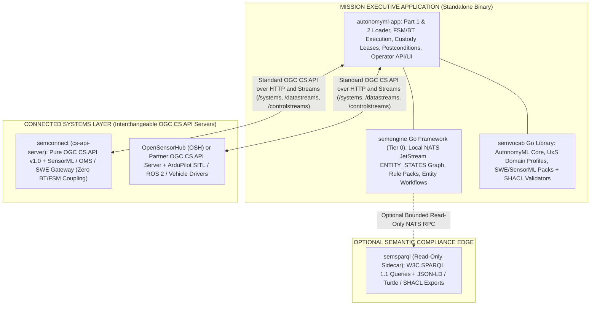
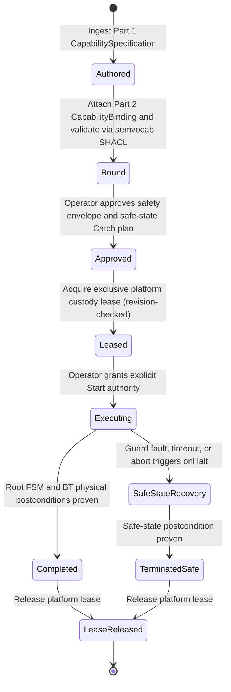
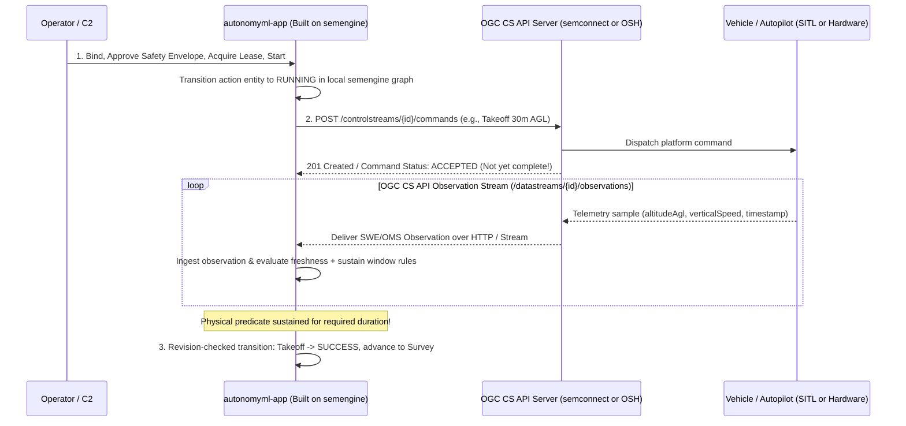
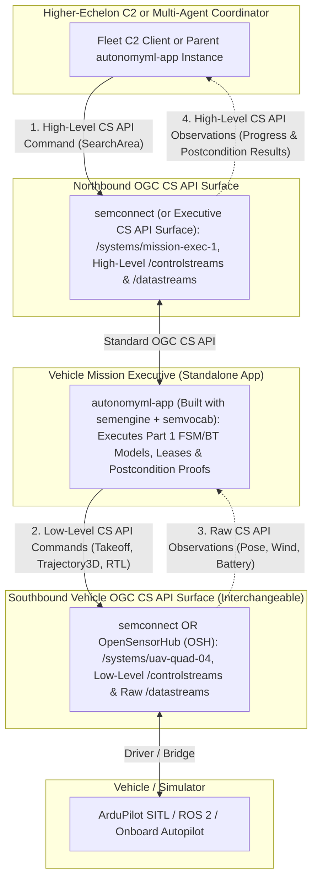

# Reference Runtime Architecture and Module Boundaries: Separating the AutonomyML Mission Executive from OGC Connected Systems

## Executive Summary

**AutonomyML** is a vendor- and runtime-neutral open specification for describing reusable, observable autonomous capabilities (see [AutonomyML Overview.md](../../AutonomyML%20Overview.md)). When building a reference implementation to execute **Part 1 (Specifications)** and **Part 2 (Bindings)**, a foundational architectural boundary must be preserved:

**AutonomyML mission execution does not belong inside the OGC API - Connected Systems (CS API) server (`semconnect`).**

Instead:
* **`semconnect`** ([C360Studio/semconnect](https://github.com/C360Studio/semconnect)) remains a dedicated, standards-conformant **OGC API - Connected Systems v1.0 + SensorML** gateway/server.
* **`autonomyml-app`** *(placeholder name)* is a **separate, standalone Mission Executive application** built using the **`semengine`** Go framework ([C360Studio/semengine](https://github.com/C360Studio/semengine)) and **`semvocab`** vocabulary/SHACL library ([C360Studio/semvocab](https://github.com/C360Studio/semvocab)).
* At runtime, **`autonomyml-app` interacts with `semconnect` over standard OGC CS API HTTP and dynamic data streams**—making `semconnect`, [OpenSensorHub (OSH)](https://opensensorhub.org/), and any other conformant OGC CS API server completely interchangeable.

---

## 1. Why AutonomyML Execution Lives Outside `semconnect`

`semconnect` is designed with a crisp single responsibility: implementing an **[OGC API - Connected Systems v1.0](https://ogcapi.ogc.org/connectedsystems/)** server and its associated OGC encodings (**OMS**, **[SensorML 3.0](https://docs.ogc.org/is/23-000/23-000.html)**, **SWE Common**, **SOSA**, and GeoJSON/JSON-LD representations) verified against the official OGC executable test suite.

Keeping AutonomyML execution out of `semconnect` is critical for two reasons:

1. **`semconnect` Must Remain Usable for Non-Autonomous Connected Systems:**
   Weather stations, environmental sensor networks, fixed or pan-tilt-zoom cameras, and manual telemetry/command gateways need OGC CS API and SensorML—without Behavior Trees, Finite State Machines, or mission-executive governance anywhere in the server binary.
2. **OGC CS API Intentionally Has No Native Concept of Mission-Executive Semantics:**
   CS API standardizes feature resources (`/systems`, `/procedures`, `/deployments`, `/samplingFeatures`) and dynamic data channels (`/datastreams`, `/observations`, `/controlstreams`, `/commands`, `/systemEvents`). It deliberately does **not** define:
   * **Reactive Behavior Tree ticks or FSM mode transitions** (`RUNNING`, `SUCCESS`, `FAILURE` propagation at $N\text{ Hz}$, `onHalt` subtree preemption, or hierarchical mode statecharts).
   * **Single-pilot platform custody leases** preventing two executives or operators from issuing conflicting actuation commands to the same vehicle.
   * **Multi-stage human authority gates** (`Mission Authoring -> Platform Binding -> Safety Approval -> Start Authority`).
   * **Sustained physical postcondition proofs** (*Command Accepted $\neq$ Action Completed*) that monitor live observation streams before advancing a multi-step plan.

Baking those four concerns into `semconnect` would turn a clean OGC protocol server into a monolith and blur the boundary between **system interaction** and **behavioral supervision** in [AutonomyML Overview.md](../../AutonomyML%20Overview.md):

| Concern in [AutonomyML Overview](../../AutonomyML%20Overview.md) | Standard / Formalism | Architectural Owner |
| :--- | :--- | :--- |
| **Interaction with a particular system** (`/systems`, `/datastreams`, `/observations`, `/controlstreams`, `/commands`) | OGC CS API (Part 1 & Part 2) | **CS API Server Layer** (`semconnect`, OpenSensorHub, or third-party CS API gateway) |
| **Computational functions, typed ports, units & CRS metadata** | OGC SensorML 3.0 + SWE Common 3.0 | **Shared Semantic Interface** (validated via `semvocab`; described on systems in CS API and composed in `autonomyml-app`) |
| **Modes and transitions** | Finite State Machines (FSMs) | **Mission Executive App** (`autonomyml-app`, built with `semengine`) |
| **Reactive task composition** | Behavior Trees (BTs) | **Mission Executive App** (`autonomyml-app`, built with `semengine`) |
| **Execution lifecycles, custody leases & physical postconditions** | AutonomyML Part 1 & Part 2 | **Mission Executive App** (`autonomyml-app`, built with `semengine`) |

---

## 2. Framework vs. Vocabulary Library vs. Independent Applications

In the C360 reference ecosystem, `semengine` is **not** a central shared daemon that couples applications together in memory. Rather, **`semengine` is a Go application framework** and **`semvocab` is a Go vocabulary/SHACL library** that independent applications compile into their own binaries—each owning its own operational state, entity authority, and public interface:

### 2.1 `semengine` — The Go Application Framework
* **Framework, Not a Monolith:** [`semengine`](https://github.com/C360Studio/semengine) is a Go framework for building applications around a live semantic knowledge graph backed by NATS JetStream, paired with deterministic rules and entity workflows. It has no domain semantics of its own; each consumer application wires its own `main` binary, registering only the `semengine` components (`graph-ingest`, `graph-index`, `graph-query`, `rule-processor`, `objectstore`, etc.) and payload types it uses.
* **Tier-0 Edge & Offline Execution:** `semengine`'s Tier-0 baseline requires **no external LLM or embedding provider**, making it purpose-built for deterministic, offline-first, edge-capable mission execution.
* **Authority, Revisions, Rules & Workflows:**
  * Entities use structured six-part dot-separated IDs (`org.platform.system.domain.type.instance`) scoped to each deployment's `org.platform` authority, with flat dotted predicates stored in NATS KV (`ENTITY_STATES`).
  * State reconciliations support optimistic concurrency via explicit **revision** checks (`revision-conflict` rejects stale concurrent writes).
  * JSON **rule packs** (validated at startup) watch entity state transitions and trigger deterministic actions, while **entity workflows** persist lifecycle phases directly on entities across restarts.

### 2.2 `semvocab` — Vocabulary Packs & SHACL Contract Library
* **Practical Runtime Terms + Standard Ontologies:** [`semvocab`](https://github.com/C360Studio/semvocab) is a Go library that populates `semengine/vocabulary` without forcing core services to manipulate raw RDF blank-node chains on the hot path.
* **Packs & SHACL Compilation:** Provides ontology IRI catalogs, modular **vocabulary packs** (registering entity types, flat dotted predicates, and standard ontology IRI projections), and a **SHACL compiler** (`shacl.Compile`) that turns W3C SHACL shapes and mappings into write contracts and complete-state entity validators.
* **For `autonomyml-app`:** Supplies the vocabulary packs and SHACL validators for SWE Common / SensorML port metadata, **AutonomyML Core** (FSM states, BT nodes, custody leases, authority phases, postconditions), and **Layer 2 UxS Domain Profiles** (Aerial, Ground Rover, Maritime).

### 2.3 `semconnect` — Standalone OGC CS API Server
* **Pure Connected Systems Gateway:** [`semconnect`](https://github.com/C360Studio/semconnect) (`cs-api-server`) is an independent consumer application owning OGC CS API Part 1 & Part 2 HTTP/stream surfaces, OMS observations, SensorML system/process descriptions, SWE Common schemas, and OGC conformance testing.
* **Decoupled from `autonomyml-app`:** `semconnect` runs its own deployment authority and storage lifecycle. It never imports AutonomyML rule packs, Behavior Tree evaluators, or mission custody logic.

### 2.4 `autonomyml-app` — Standalone AutonomyML Mission Executive
* **Built on `semengine` + `semvocab`:** `autonomyml-app` is an independent consumer application whose `main` composes `semengine`'s Tier-0 graph, rule processor, and entity workflow primitives with AutonomyML `semvocab` packs.
* **Speaks Standard OGC CS API Externally:** Connects to target platforms through standard OGC CS API endpoints—meaning `autonomyml-app` treats `semconnect`, OpenSensorHub, or any conformant CS API vehicle gateway identically.

### 2.5 `semsparql` *(Optional)* — Read-Only Semantic Audit Sidecar
* When a program or assurance workflow requires external W3C SPARQL 1.1 queries (`SELECT`, `ASK`, `CONSTRUCT`, `DESCRIBE`) or unfolded JSON-LD / Turtle exports for external SHACL compliance gates, [`semsparql`](https://github.com/C360Studio/semsparql) attaches beside a `semengine` deployment as a bounded, **read-only** translator—never mutating live mission state.

---

## 3. What `autonomyml-app` Owns as the Mission Executive

Building `autonomyml-app` on `semengine` and `semvocab` maps every Mission Executive responsibility cleanly onto deterministic framework primitives while keeping external vehicle interactions 100% standard OGC CS API:

### 3.1 Part 1 & Part 2 Ingestion and Profile Validation
* Parses portable **AutonomyML Part 1 (`CapabilitySpecification`)** models and **Part 2 (`CapabilityBinding`)** documents.
* Uses `semvocab`-compiled SHACL validators and vocabulary packs to verify SWE Common units of measure, coordinate reference frames (e.g., `EPSG:4326` vs. `EPSG:4979` + `AGL`), required domain-profile safe-state `Catch` handlers, and bound CS API `/datastreams` and `/controlstreams` schemas before execution is ever armed.

### 3.2 FSM Mode Supervision & Reactive Behavior Tree Execution
* Tracks macro-modes (e.g., `Takeoff`, `Survey`, `ExecuteRTL`, `SafeHoldFallback`) and reactive Behavior Tree node states (`RUNNING`, `SUCCESS`, `FAILURE`) as typed entities in `autonomyml-app`'s local `semengine` graph.
* Compiles mode transitions, guard conditions, and fault escalations into startup-validated `semengine` rule packs and revision-checked entity workflows—invoking explicit `onHalt` preemption commands on active CS API `ControlStreams` whenever a reactive guard fails or an operator aborts.

### 3.3 Custody Leases & Human Authority Gates (`Author -> Bind -> Approve -> Start`)
Because OGC CS API intentionally allows any authorized client to `POST` commands to a `/controlstream`, safety-critical UxS governance lives in `autonomyml-app`'s entity workflows:

* **Substantiates Part 1 of AutonomyML:** Directly implements *Execution Lifecycles* and *Resource Coordination* from [AutonomyML Overview.md](../../AutonomyML%20Overview.md) without adding proprietary HTTP verbs to OGC CS API.
* **Prevents Split-Brain Actuation:** Optimistic `revision` checks on entity state inside `autonomyml-app` ensure two concurrent transitions or competing mission runs cannot simultaneously claim custody of the same bound platform.

### 3.4 Sustained Physical Postcondition Proofs (*Command Accepted $\neq$ Action Completed*)

---

## 4. Hierarchical Autonomy via Standard OGC CS API

Keeping `autonomyml-app` decoupled from `semconnect` and communicating strictly over **OGC CS API** unlocks **hierarchical (recursive) autonomy** directly aligned with the **AutonomyML Goal**:

> *"AutonomyML ensures that different independent autonomous UxS system implementations publish their autonomy capabilities openly via a standard that enables the description of equivalent observable behavior, without relying on undocumented conventions inside its components."*
> — [AutonomyML Overview.md](../../AutonomyML%20Overview.md)

Because `autonomyml-app` defines its own high-level capabilities (such as `SearchArea`, `InspectTarget`, or `TakeoffSurveyAndRTL`) using **SensorML-typed inputs, parameters, and outputs**, the Mission Executive itself can be published and tasked northbound as a standard OGC Connected System:

1. **Southbound Portability (`semconnect` $\leftrightarrow$ OpenSensorHub):**
   `autonomyml-app` consumes raw vehicle `/datastreams` and tasks low-level `/controlstreams` over standard OGC CS API. Switching a testbed from an OpenSensorHub + ArduPilot SITL simulator to a `semconnect`-fronted platform requires **only a Part 2 `CapabilityBinding` URL/stream change**—zero code changes in `autonomyml-app` and zero changes to the Part 1 `CapabilitySpecification`.
2. **Northbound Composability (Multi-Echelon C2 & Swarms):**
   Higher-echelon C2 tools—or a parent **Layer 3 Multi-Agent Coordinator**—do not need a proprietary RPC protocol to talk to `autonomyml-app`. They discover the executive's published SensorML capabilities, issue high-level commands to `/controlstreams`, and monitor mission progress on `/datastreams` using standard OGC CS API.

---

## 5. Summary of Repository and Application Boundaries

| Repository / App | Kind | Primary Responsibility | Explicit Non-Goals (Kept Out of Scope) |
| :--- | :--- | :--- | :--- |
| **`autonomyml`** *(this repo)* | **Open Specification** | Vendor-neutral AutonomyML Part 1 (Specifications), Part 2 (Bindings), domain profile definitions, schemas, and architectural documentation. | Tying the open language standard to any single vendor's internal wire bus or proprietary runtime. |
| **[`semvocab`](https://github.com/C360Studio/semvocab)** | **Go Library** | Ontology IRI catalogs, modular vocabulary packs (OGC terms, AutonomyML Core, UxS Domain Profiles), and SHACL-to-contract/validator compilation for `semengine`. | Running network servers, storing live runtime state, or executing mission loops. |
| **[`semengine`](https://github.com/C360Studio/semengine)** | **Go Framework** | Tier-0 offline/edge-capable NATS JetStream knowledge graph (`ENTITY_STATES`), optimistic revision-checked writes, entity workflows, and JSON rule-pack engine. | Domain-specific OGC CS API HTTP routes, SensorML parsers, or AutonomyML BT/FSM semantics. |
| **[`semconnect`](https://github.com/C360Studio/semconnect)** | **Standalone App** | Pure OGC API - Connected Systems v1.0 + SensorML / OMS / SWE server (`cs-api-server`) verified against OGC conformance suites; interchangeable with OpenSensorHub. | Behavior Tree ticking, FSM mission supervision, custody leases, approval gates, or postcondition loops. |
| **`autonomyml-app`** *(placeholder)* | **Standalone App** | Reference AutonomyML Mission Executive built using `semengine` + `semvocab`; executes Part 1/2 models, leases, authority gates, and postconditions against any OGC CS API server. | Re-implementing an OGC CS API server monolith or embedding raw autopilot wire drivers directly in plans. |
| **[`semsparql`](https://github.com/C360Studio/semsparql)** *(optional)* | **Read-Only Sidecar** | Edge translator for W3C SPARQL 1.1 queries and unfolded JSON-LD / Turtle exports for external SHACL compliance and audit workflows. | Mutating live operational state or sitting in the real-time vehicle control loop. |

---

## 6. References

1. **AutonomyML Overview** — [AutonomyML Overview.md](../../AutonomyML%20Overview.md)
2. **OGC API - Connected Systems — Part 1: Feature Resources (OGC 23-001) & Part 2: Dynamic Data (OGC 23-002)** — [https://ogcapi.ogc.org/connectedsystems/](https://ogcapi.ogc.org/connectedsystems/)
3. **OGC Sensor Model Language (SensorML) 3.0 Standard (OGC 23-000)** — [https://docs.ogc.org/is/23-000/23-000.html](https://docs.ogc.org/is/23-000/23-000.html)
4. **OGC SWE Common Data Model 3.0 Standard (OGC 24-014)** — [https://www.ogc.org/standards/swecommon/](https://www.ogc.org/standards/swecommon/)
5. **OpenSensorHub (OSH)** — [https://opensensorhub.org/](https://opensensorhub.org/)
6. **C360Studio SemEngine (Go Knowledge-Graph & Durable Execution Framework)** — [https://github.com/C360Studio/semengine](https://github.com/C360Studio/semengine)
7. **C360Studio SemVocab (Ontology Packs & SHACL Compiler)** — [https://github.com/C360Studio/semvocab](https://github.com/C360Studio/semvocab)
8. **C360Studio SemConnect (OGC API - Connected Systems Gateway)** — [https://github.com/C360Studio/semconnect](https://github.com/C360Studio/semconnect)
9. **C360Studio SemSparql (Read-Only W3C SPARQL 1.1 & RDF/JSON-LD Sidecar)** — [https://github.com/C360Studio/semsparql](https://github.com/C360Studio/semsparql)
